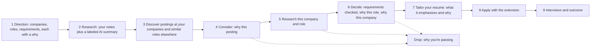

# Unhurried

A job search run as a deliberate process: decide where you want to work and why, research it, find the postings that fit, and take each one through stages that each need your written reason, from considering it to tailoring your resume, applying, and interviewing. Split into independent git repositories and deployed on Google Cloud managed services.

**Why:** AI auto-apply tools have flooded every role with applicants and left both job seekers and recruiters worse off. Unhurried uses AI the other way round: as a personal researcher that finds a small, curated set of roles worth pursuing deliberately, so candidates can apply to fewer places with real intent and fit. Read the full [motivation](MOTIVATION.md).

## The process



Every arrow out of a stage is a **gate**: the server refuses the move until that stage's reason is written (at least 30 characters). Dropping an opportunity needs a reason too, which becomes a record of what you learned. At most five opportunities can be decided on at once.

| Motivation | Feature |
| --- | --- |
| Know which companies you want, and why, before roles are posted widely | **Direction**: target companies and roles, each with your reason, plus the must-haves and dealbreakers every role is checked against. Unhurried reads each company's own Greenhouse, Lever, or Ashby board |
| Learn about the company and the role first | **Research**: your own notes and sources on each target, next to an AI summary from Gemini with Google Search, always labeled and never writing your reasons for you |
| Find the roles worth your time | **Discover**: postings at your target companies and similar roles elsewhere, each saying why it surfaced; a daily email digest of what's new |
| Think critically about each role | **Opportunity stepper**: Consider, Research, Decide, Resume, Apply, Interviews. Deciding needs every requirement checked with evidence and your why for the role and the company |
| Find team members and learn about the role, culture, and day-to-day | **Outreach kit and Conversations**: LinkedIn searches you open yourself, questions worth asking, drafted messages asking people for a few minutes of their time, your booking link, and what you learned from each person |
| Customize materials intentionally | **Resume step**: copy your master Google Doc for the role and tailor it with Gemini, led by your own reasons; it never adds experience you don't have |
| Apply on purpose | **Chrome extension**: lists only the opportunities whose resume is ready, fills the form, and records the submit after you press Submit yourself |

## Documentation

Full documentation is in [docs/](docs/README.md): [architecture](docs/architecture.md), [codebase guide](docs/codebase.md), [CI/CD](docs/ci-cd.md), [security](docs/security.md), and [implementation status](docs/status.md).

## CI/CD Status Dashboard

<!-- CI_STATUS_START -->

## 🚀 Unhurried CI/CD Pipeline Status Dashboard

> **Global Status:** 🟡 **Workflows In Progress**  
> **Last Synchronized:** `Sun, 08 Nov 2026 21:05:37 GMT`  
> **Security Boundary:** Pure Continuous Integration (GitHub Actions) with `permissions: contents: read` · Zero Google Cloud secrets in GitHub

### 📊 Health & Reliability Summary

| Total Repositories | Tracked CI Pipelines | Passing on `main` | Success Rate | Average Runtime | Security Model |
| :---: | :---: | :---: | :---: | :---: | :---: |
| **10** | **10** | **9 / 10** | **0%** | **0m 4s** | **Zero GCP Keys** |

### 🛠 Pipeline Matrix

| Status | Service | Role | Target | Branch | Commit | Duration | Workflow Run |
| :---: | :--- | :--- | :--- | :---: | :---: | :---: | :---: |
| 🟡 **Running** | [**Job Search & Discovery**](https://github.com/Unhurried-Careers/unhurried-job-search)<br/>`unhurried-job-search` | Direction, research with AI summaries, and discovery of postings | `Cloud Run · Go 1.23` | `dev` | [`7d65e5d`](https://github.com/Unhurried-Careers/unhurried-job-search/commit/7d65e5d44dd5ea6f2d6c836906c7db62b3ee0fa5) | 0m 3s | [Run #42523393713 ↗](https://github.com/Unhurried-Careers/unhurried-job-search/actions/runs/42523393713) |
| 🟡 **Running** | [**Resume Studio**](https://github.com/Unhurried-Careers/unhurried-resume)<br/>`unhurried-resume` | Google Docs/Drive resume copies and Vertex AI tailoring | `Cloud Run · Go 1.23` | `dev` | [`4d19ec9`](https://github.com/Unhurried-Careers/unhurried-resume/commit/4d19ec9817412352871d32be8c3c7c8479cc2579) | 0m 3s | [Run #42523404179 ↗](https://github.com/Unhurried-Careers/unhurried-resume/actions/runs/42523404179) |
| 🟡 **Running** | [**Opportunity Pipeline**](https://github.com/Unhurried-Careers/unhurried-applications)<br/>`unhurried-applications` | Opportunity stages and gates, outreach kit, conversations & interview rounds | `Cloud Run · Go 1.23` | `dev` | [`b4be05a`](https://github.com/Unhurried-Careers/unhurried-applications/commit/b4be05abc4e84c37f56fe45849d2416b084478d2) | 0m 3s | [Run #42523402210 ↗](https://github.com/Unhurried-Careers/unhurried-applications/actions/runs/42523402210) |
| 🟡 **Running** | [**Notifications & Alerts**](https://github.com/Unhurried-Careers/unhurried-notifications)<br/>`unhurried-notifications` | Email digests of new postings for your targets via SMTP | `Cloud Run · Go 1.23` | `dev` | [`9765b67`](https://github.com/Unhurried-Careers/unhurried-notifications/commit/9765b67fcf6250ed0f007de23d8976dcff993564) | 0m 3s | [Run #42523395977 ↗](https://github.com/Unhurried-Careers/unhurried-notifications/actions/runs/42523395977) |
| 🟡 **Running** | [**Inbox & Calendar**](https://github.com/Unhurried-Careers/unhurried-inbox)<br/>`unhurried-inbox` | Google Calendar interview detection | `Cloud Run · Go 1.23` | `dev` | [`b7d2658`](https://github.com/Unhurried-Careers/unhurried-inbox/commit/b7d26582a040b5d5769d1879886a342b98d4e454) | 0m 3s | [Run #42523397862 ↗](https://github.com/Unhurried-Careers/unhurried-inbox/actions/runs/42523397862) |
| 🟡 **Running** | [**Common Library**](https://github.com/Unhurried-Careers/unhurried-common)<br/>`unhurried-common` | Shared Go library: auth, HTTP hardening, validation, models | `Go Module · v0.1` | `dev` | [`6c4cc7e`](https://github.com/Unhurried-Careers/unhurried-common/commit/6c4cc7e1a4b4fcbcacf8e8ab2115857102f715d3) | 0m 3s | [Run #42523384617 ↗](https://github.com/Unhurried-Careers/unhurried-common/actions/runs/42523384617) |
| 🟡 **Running** | [**Web App (SPA)**](https://github.com/Unhurried-Careers/unhurried-web)<br/>`unhurried-web` | TypeScript React frontend deployed to Firebase Hosting CDN | `Firebase Hosting · Global CDN` | `dev` | [`cc03c99`](https://github.com/Unhurried-Careers/unhurried-web/commit/cc03c99c9a58c96a86b3eac055f838b5f8d865f1) | 0m 3s | [Run #42523409829 ↗](https://github.com/Unhurried-Careers/unhurried-web/actions/runs/42523409829) |
| 🟡 **Running** | [**Chrome Extension**](https://github.com/Unhurried-Careers/unhurried-extension)<br/>`unhurried-extension` | Chrome MV3 job application assistant | `Cloud Storage · Artifacts` | `dev` | [`87f27fd`](https://github.com/Unhurried-Careers/unhurried-extension/commit/87f27fd5cc199c8bf2dbe65358ab4214c94aa57b) | 0m 3s | [Run #42523412581 ↗](https://github.com/Unhurried-Careers/unhurried-extension/actions/runs/42523412581) |
| 🟡 **Running** | [**Infrastructure & Specs**](https://github.com/Unhurried-Careers/unhurried-infra)<br/>`unhurried-infra` | Terraform GCP infrastructure, API Gateway specs, and security rules | `Terraform · GCP Prod & Staging` | `dev` | [`c83ac0f`](https://github.com/Unhurried-Careers/unhurried-infra/commit/c83ac0f54be4f20e1826388611f11da4c6921311) | 0m 9s | [Run #42523407064 ↗](https://github.com/Unhurried-Careers/unhurried-infra/actions/runs/42523407064) |
| 🟡 **Running** | [**Product & Architecture**](https://github.com/Unhurried-Careers/unhurried-product)<br/>`unhurried-product` | System specifications, architecture guides, and CI/CD dashboard | `Documentation & Meta` | `dev` | [`5df7ee8`](https://github.com/Unhurried-Careers/unhurried-product/commit/5df7ee8b309b485111568de6f3674454c23f1ff9) | 0m 3s | [Run #42523414944 ↗](https://github.com/Unhurried-Careers/unhurried-product/actions/runs/42523414944) |

### 🔍 Deep Step-by-Step CI Verifications

<details>
<summary><b>Job Search & Discovery (unhurried-job-search)</b> — Latest Run #42523393713 (<code>7d65e5d</code>) — <i>CI runs on dev, and dev builds use unhurried-common@dev</i></summary>

**Job:** `Lint and test` (running)

| Step | Status |
| :--- | :---: |
| Set up job | ✓ `success` |
| Check out unhurried-job-search | ✓ `success` |
| Mint read-only token for unhurried-common | ✓ `success` |
| Check out unhurried-common | ✓ `success` |
| Run actions/setup-go@v5 | • `in_progress` |
| gofmt | • `pending` |
| go vet | • `pending` |
| go test | • `pending` |
| Coverage summary | • `pending` |
| Run actions/upload-artifact@v4 | • `pending` |
| govulncheck | • `pending` |
| Post Run actions/setup-go@v5 | • `pending` |
| Post Check out unhurried-common | • `pending` |
| Post Mint read-only token for unhurried-common | • `pending` |
| Post Check out unhurried-job-search | • `pending` |

</details>

<details>
<summary><b>Resume Studio (unhurried-resume)</b> — Latest Run #42523404179 (<code>4d19ec9</code>) — <i>CI runs on dev, and dev builds use unhurried-common@dev</i></summary>

**Job:** `Lint and test` (running)

| Step | Status |
| :--- | :---: |
| Set up job | ✓ `success` |
| Check out unhurried-resume | ✓ `success` |
| Mint read-only token for unhurried-common | ✓ `success` |
| Check out unhurried-common | ✓ `success` |
| Run actions/setup-go@v5 | • `in_progress` |
| gofmt | • `pending` |
| go vet | • `pending` |
| go test | • `pending` |
| Coverage summary | • `pending` |
| Run actions/upload-artifact@v4 | • `pending` |
| govulncheck | • `pending` |
| Post Run actions/setup-go@v5 | • `pending` |
| Post Check out unhurried-common | • `pending` |
| Post Mint read-only token for unhurried-common | • `pending` |
| Post Check out unhurried-resume | • `pending` |

</details>

<details>
<summary><b>Opportunity Pipeline (unhurried-applications)</b> — Latest Run #42523402210 (<code>b4be05a</code>) — <i>CI runs on dev, and dev builds use unhurried-common@dev</i></summary>

**Job:** `Lint and test` (running)

| Step | Status |
| :--- | :---: |
| Set up job | ✓ `success` |
| Check out unhurried-applications | ✓ `success` |
| Mint read-only token for unhurried-common | ✓ `success` |
| Check out unhurried-common | ✓ `success` |
| Run actions/setup-go@v5 | • `in_progress` |
| gofmt | • `pending` |
| go vet | • `pending` |
| go test | • `pending` |
| Coverage summary | • `pending` |
| Run actions/upload-artifact@v4 | • `pending` |
| govulncheck | • `pending` |
| Post Run actions/setup-go@v5 | • `pending` |
| Post Check out unhurried-common | • `pending` |
| Post Mint read-only token for unhurried-common | • `pending` |
| Post Check out unhurried-applications | • `pending` |

</details>

<details>
<summary><b>Notifications & Alerts (unhurried-notifications)</b> — Latest Run #42523395977 (<code>9765b67</code>) — <i>CI runs on dev, and dev builds use unhurried-common@dev</i></summary>

**Job:** `Lint and test` (running)

| Step | Status |
| :--- | :---: |
| Set up job | ✓ `success` |
| Check out unhurried-notifications | ✓ `success` |
| Mint read-only token for unhurried-common | ✓ `success` |
| Check out unhurried-common | ✓ `success` |
| Run actions/setup-go@v5 | ✓ `success` |
| gofmt | ✓ `success` |
| go vet | ✓ `success` |
| go test | • `in_progress` |
| Coverage summary | • `pending` |
| Run actions/upload-artifact@v4 | • `pending` |
| govulncheck | • `pending` |
| Post Run actions/setup-go@v5 | • `pending` |
| Post Check out unhurried-common | • `pending` |
| Post Mint read-only token for unhurried-common | • `pending` |
| Post Check out unhurried-notifications | • `pending` |

</details>

<details>
<summary><b>Inbox & Calendar (unhurried-inbox)</b> — Latest Run #42523397862 (<code>b7d2658</code>) — <i>CI runs on dev, and dev builds use unhurried-common@dev</i></summary>

**Job:** `Lint and test` (running)

| Step | Status |
| :--- | :---: |
| Set up job | ✓ `success` |
| Check out unhurried-inbox | ✓ `success` |
| Mint read-only token for unhurried-common | ✓ `success` |
| Check out unhurried-common | ✓ `success` |
| Run actions/setup-go@v5 | • `in_progress` |
| gofmt | • `pending` |
| go vet | • `pending` |
| go test | • `pending` |
| Coverage summary | • `pending` |
| Run actions/upload-artifact@v4 | • `pending` |
| govulncheck | • `pending` |
| Post Run actions/setup-go@v5 | • `pending` |
| Post Check out unhurried-common | • `pending` |
| Post Mint read-only token for unhurried-common | • `pending` |
| Post Check out unhurried-inbox | • `pending` |

</details>

<details>
<summary><b>Common Library (unhurried-common)</b> — Latest Run #42523384617 (<code>6c4cc7e</code>) — <i>CI runs on dev pushes</i></summary>

**Job:** `Lint and test` (running)

| Step | Status |
| :--- | :---: |
| Set up job | ✓ `success` |
| Run actions/checkout@v4 | ✓ `success` |
| Run actions/setup-go@v5 | ✓ `success` |
| gofmt | ✓ `success` |
| go vet | ✓ `success` |
| go test | • `in_progress` |
| Coverage summary | • `pending` |
| Run actions/upload-artifact@v4 | • `pending` |
| govulncheck | • `pending` |
| Post Run actions/setup-go@v5 | • `pending` |
| Post Run actions/checkout@v4 | • `pending` |

</details>

<details>
<summary><b>Web App (SPA) (unhurried-web)</b> — Latest Run #42523409829 (<code>cc03c99</code>) — <i>CI runs on dev pushes</i></summary>

**Job:** `Typecheck, test, build` (running)

| Step | Status |
| :--- | :---: |
| Set up job | ✓ `success` |
| Run actions/checkout@v4 | ✓ `success` |
| Run actions/setup-node@v4 | ✓ `success` |
| Run npm ci | ✓ `success` |
| Typecheck | • `in_progress` |
| Unit tests with coverage thresholds | • `pending` |
| Coverage summary | • `pending` |
| Run actions/upload-artifact@v4 | • `pending` |
| Production build check | • `pending` |
| Audit runtime dependencies | • `pending` |
| Post Run actions/setup-node@v4 | • `pending` |
| Post Run actions/checkout@v4 | • `pending` |

</details>

<details>
<summary><b>Chrome Extension (unhurried-extension)</b> — Latest Run #42523412581 (<code>87f27fd</code>) — <i>CI runs on dev pushes</i></summary>

**Job:** `Test and package` (running)

| Step | Status |
| :--- | :---: |
| Set up job | ✓ `success` |
| Run actions/checkout@v4 | ✓ `success` |
| Run actions/setup-node@v4 | ✓ `success` |
| Run npm ci | ✓ `success` |
| Unit tests with coverage thresholds | ✓ `success` |
| Package extension | ✓ `success` |
| Run actions/upload-artifact@v4 | • `in_progress` |
| Post Run actions/setup-node@v4 | • `pending` |
| Post Run actions/checkout@v4 | • `pending` |

</details>

<details>
<summary><b>Infrastructure & Specs (unhurried-infra)</b> — Latest Run #42523407064 (<code>c83ac0f</code>) — <i>CI runs on dev, and dev compares gateway specs with the services' dev…</i></summary>

**Job:** `Checkov (informational)` (running)

| Step | Status |
| :--- | :---: |
| Set up job | ✓ `success` |
| Pull ghcr.io/bridgecrewio/checkov:3.4.3 | ✓ `success` |
| Run actions/checkout@v4 | ✓ `success` |
| Checkov | • `in_progress` |
| Post Run actions/checkout@v4 | • `pending` |

**Job:** `Terraform fmt, validate, test` (running)

| Step | Status |
| :--- | :---: |
| Set up job | ✓ `success` |
| Run actions/checkout@v4 | ✓ `success` |
| Run hashicorp/setup-terraform@v3 | ✓ `success` |
| Run mkdir -p "$TF_PLUGIN_CACHE_DIR" | ✓ `success` |
| terraform fmt | ✓ `success` |
| validate and test each module | • `in_progress` |
| Post Run actions/checkout@v4 | • `pending` |

**Job:** `Gateway specs match service repos (unhurried-inbox, inbox.yaml)` (success)

| Step | Status |
| :--- | :---: |
| Set up job | ✓ `success` |
| Run actions/checkout@v4 | ✓ `success` |
| Mint read-only token for unhurried-inbox | ✓ `success` |
| Run actions/checkout@v4 | ✓ `success` |
| Compare specs | ✓ `success` |
| Post Run actions/checkout@v4 | ✓ `success` |
| Post Mint read-only token for unhurried-inbox | ✓ `success` |
| Post Run actions/checkout@v4 | ✓ `success` |
| Complete job | ✓ `success` |

**Job:** `Gateway specs match service repos (unhurried-applications, applications.yaml)` (success)

| Step | Status |
| :--- | :---: |
| Set up job | ✓ `success` |
| Run actions/checkout@v4 | ✓ `success` |
| Mint read-only token for unhurried-applications | ✓ `success` |
| Run actions/checkout@v4 | ✓ `success` |
| Compare specs | ✓ `success` |
| Post Run actions/checkout@v4 | ✓ `success` |
| Post Mint read-only token for unhurried-applications | ✓ `success` |
| Post Run actions/checkout@v4 | ✓ `success` |
| Complete job | ✓ `success` |

**Job:** `Lint gateway specs` (success)

| Step | Status |
| :--- | :---: |
| Set up job | ✓ `success` |
| Run actions/checkout@v4 | ✓ `success` |
| Run actions/setup-node@v4 | ✓ `success` |
| Run npm ci | ✓ `success` |
| Run npm run check-specs | ✓ `success` |
| Post Run actions/setup-node@v4 | ✓ `success` |
| Post Run actions/checkout@v4 | ✓ `success` |
| Complete job | ✓ `success` |

**Job:** `Gateway specs match service repos (unhurried-resume, resume.yaml)` (success)

| Step | Status |
| :--- | :---: |
| Set up job | ✓ `success` |
| Run actions/checkout@v4 | ✓ `success` |
| Mint read-only token for unhurried-resume | ✓ `success` |
| Run actions/checkout@v4 | ✓ `success` |
| Compare specs | ✓ `success` |
| Post Run actions/checkout@v4 | ✓ `success` |
| Post Mint read-only token for unhurried-resume | ✓ `success` |
| Post Run actions/checkout@v4 | ✓ `success` |
| Complete job | ✓ `success` |

**Job:** `Gateway specs match service repos (unhurried-notifications, notifications.yaml)` (success)

| Step | Status |
| :--- | :---: |
| Set up job | ✓ `success` |
| Run actions/checkout@v4 | ✓ `success` |
| Mint read-only token for unhurried-notifications | ✓ `success` |
| Run actions/checkout@v4 | ✓ `success` |
| Compare specs | ✓ `success` |
| Post Run actions/checkout@v4 | ✓ `success` |
| Post Mint read-only token for unhurried-notifications | ✓ `success` |
| Post Run actions/checkout@v4 | ✓ `success` |
| Complete job | ✓ `success` |

**Job:** `Gateway specs match service repos (unhurried-job-search, job-search.yaml)` (success)

| Step | Status |
| :--- | :---: |
| Set up job | ✓ `success` |
| Run actions/checkout@v4 | ✓ `success` |
| Mint read-only token for unhurried-job-search | ✓ `success` |
| Run actions/checkout@v4 | ✓ `success` |
| Compare specs | ✓ `success` |
| Post Run actions/checkout@v4 | ✓ `success` |
| Post Mint read-only token for unhurried-job-search | ✓ `success` |
| Post Run actions/checkout@v4 | ✓ `success` |
| Complete job | ✓ `success` |

</details>

<details>
<summary><b>Product & Architecture (unhurried-product)</b> — Latest Run #42523414944 (<code>5df7ee8</code>) — <i>Make dev the working branch: dashboard commits to the default branch;…</i></summary>

**Job:** `Refresh Status & Generate Dashboard` (running)

| Step | Status |
| :--- | :---: |
| Set up job | ✓ `success` |
| Check out unhurried-product | ✓ `success` |
| Set up Node.js | ✓ `success` |
| Fetch pipeline statuses across all repositories | • `in_progress` |
| Validate dashboard test suite | • `pending` |
| Generate GitHub Step Summary & update README.md | • `pending` |
| Commit and push updated status matrix | • `pending` |
| Upload dashboard artifact | • `pending` |
| Setup Pages | • `pending` |
| Upload Pages artifact | • `pending` |
| Deploy to GitHub Pages | • `pending` |
| Post Set up Node.js | • `pending` |
| Post Check out unhurried-product | • `pending` |

</details>


<!-- CI_STATUS_END -->

Monitor real-time pipeline status, test runs, and deployment health across all 10 repositories via the [CI/CD Dashboard](dashboard/README.md):
- View directly on GitHub: Check the **[Actions Tab](https://github.com/Unhurried-Careers/unhurried-product/actions)** for live Step Summary dashboards.
- Open `dashboard/index.html` directly in your browser, or
- Start the live dashboard server: `cd dashboard && npm start` (runs on `http://localhost:3000`)
- Update the status snapshot anytime: `cd dashboard && npm run fetch`

## Repositories

| Repo | Role |
| --- | --- |
| [unhurried-infra](https://github.com/Unhurried-Careers/unhurried-infra) | Terraform for GCP (API Gateway, Cloud Run, Firestore, Scheduler, Firebase Auth + Hosting) |
| [unhurried-common](https://github.com/Unhurried-Careers/unhurried-common) | Shared Go library (auth, HTTP hardening, validation, models) |
| [unhurried-job-search](https://github.com/Unhurried-Careers/unhurried-job-search) | Direction, research notes and AI summaries (Vertex AI with Google Search), discovery of postings |
| [unhurried-resume](https://github.com/Unhurried-Careers/unhurried-resume) | Resume records, Google Docs/Drive connection, and AI resume tailoring (Vertex AI) |
| [unhurried-applications](https://github.com/Unhurried-Careers/unhurried-applications) | The opportunity pipeline and its gates, outreach kit, conversations, interview rounds, extension API |
| [unhurried-notifications](https://github.com/Unhurried-Careers/unhurried-notifications) | Email digests of new postings for your target companies and roles |
| [unhurried-inbox](https://github.com/Unhurried-Careers/unhurried-inbox) | Google Calendar interview discovery |
| [unhurried-web](https://github.com/Unhurried-Careers/unhurried-web) | TypeScript React frontend (static, on Firebase Hosting) |
| [unhurried-extension](https://github.com/Unhurried-Careers/unhurried-extension) | Chrome MV3 apply assistant |

Each folder is its **own git repository** with `dev` (the default branch, where work happens), `staging`, and `main` (production) branches.

## Three tiers

1. **Frontend** — `unhurried-web` is a static single-page app on Firebase Hosting (global CDN): a public homepage at `/` and the signed-in app at `/app`. It and `unhurried-extension` call the HTTPS API Gateways.
2. **Backend** — five Go Cloud Run services, each fronted by its own API Gateway.
3. **Data** — Cloud Firestore (Native mode), plus read-only Google Calendar (interviews) and Google Drive (resumes) connections.

## Sign in

Users sign in with Google (Firebase Authentication / Identity Platform). API Gateway requires a valid Firebase ID token and the web app's API key (with per-minute quotas). Each Go service then re-verifies the token, requires a Firebase App Check token, and admits only the Google accounts in `allowed_emails`. Details are in `unhurried-infra/README.md` (API security) and `unhurried-web/README.md`.

## Local run (no GCP required)

Each Go service supports `STORE=memory` and listens on a dedicated port. `AUTH_DEV_BYPASS=true` replaces Google sign-in with `user:<id>` dev tokens (pair it with `VITE_AUTH_MODE=dev` in the web app). To use real Google sign-in locally, set `FIREBASE_PROJECT_ID` instead. From PowerShell:

```powershell
$env:AUTH_DEV_BYPASS = "true"
$env:STORE = "memory"
$env:PORT  = "8081"; go -C unhurried-job-search run ./cmd/server
$env:PORT  = "8082"; go -C unhurried-resume run ./cmd/server
$env:PORT  = "8083"; go -C unhurried-applications run ./cmd/server
$env:PORT  = "8084"; go -C unhurried-notifications run ./cmd/server
$env:PORT  = "8085"; go -C unhurried-inbox run ./cmd/server
cd unhurried-web; npm install; npm run dev
```

Copy `unhurried-web/.env.example` to `.env.local` and set `VITE_AUTH_MODE=dev` for this offline setup.

## Deploy

See `unhurried-infra/README.md` and `docs/ci-cd.md`. GitHub Actions (`.github/workflows/ci.yml`) runs pure CI on every pull request and commit with zero Google Cloud credentials. Pushes to `main` (production, https://unhurried-careers.com) and `staging` run Continuous Delivery natively inside Google Cloud via **Cloud Build** and **Google Cloud Deploy**: service images go to Artifact Registry with verified SLSA provenance and roll out to Cloud Run with post-deploy health verification, the frontend is published to Firebase Hosting, and Terraform applies the infrastructure using Secret Manager. Work lands on `dev` (CI only), then is promoted by merging `dev` into `staging` and `staging` into `main`.
