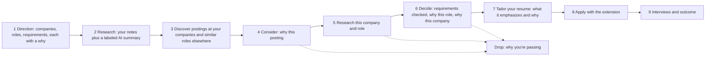

# Unhurried

A job search run as a deliberate process: decide where you want to work and why, research it, find the postings that fit, and take each one through stages that each need your written reason, from considering it to tailoring your resume, applying, and interviewing. Split into independent git repositories and deployed on Google Cloud managed services.

**Why:** AI auto-apply tools have flooded every role with applicants and left both job seekers and recruiters worse off. Unhurried uses AI the other way round: as a personal researcher that finds a small, curated set of roles worth pursuing deliberately, so candidates can apply to fewer places with real intent and fit. Read the full [motivation](MOTIVATION.md).

## The process



Every arrow out of a stage is a **gate**: the server refuses the move until that stage's reason is written (at least 30 characters). Dropping an opportunity needs a reason too, which becomes a record of what you learned. At most five opportunities can be decided on at once.

| Motivation | Feature |
| --- | --- |
| Know which companies you want, and why, before roles are posted widely | **Direction**: target companies and roles, each with your reason, plus the must-haves and dealbreakers every role is checked against. Unhurried reads each company's own Greenhouse, Lever, or Ashby board |
| Learn about the company and the role first | **Research**: your own notes and sources on each target, next to an AI summary from Gemini with Google Search, always labeled and never writing your reasons for you |
| Find the roles worth your time | **Discover**: postings at your target companies and similar roles elsewhere, each saying why it surfaced; a daily email digest of what's new |
| Think critically about each role | **Opportunity stepper**: Consider, Research, Decide, Resume, Apply, Interviews. Deciding needs every requirement checked with evidence and your why for the role and the company |
| Find team members and learn about the role, culture, and day-to-day | **Outreach kit and Conversations**: LinkedIn searches you open yourself, questions worth asking, drafted messages asking people for a few minutes of their time, your booking link, and what you learned from each person |
| Customize materials intentionally | **Resume step**: copy your master Google Doc for the role and tailor it with Gemini, led by your own reasons; it never adds experience you don't have |
| Apply on purpose | **Chrome extension**: lists only the opportunities whose resume is ready, fills the form, and records the submit after you press Submit yourself |

## Documentation

Full documentation is in [docs/](docs/README.md): [architecture](docs/architecture.md), [codebase guide](docs/codebase.md), [CI/CD](docs/ci-cd.md), [security](docs/security.md), [versioning policy](docs/versioning.md), and [implementation status](docs/status.md). Interactive API documentation with multi-environment switching (Dev, Staging, Production) is published at [docs.unhurried-careers.com](https://docs.unhurried-careers.com).

## CI/CD status

Live status of every repository's CI and every environment's deploys, and which promotions are pending, is at https://status.unhurried-careers.com. It is built from [unhurried-ops](https://github.com/Unhurried-Careers/unhurried-ops) and runs in its own Google Cloud project.

## Repositories

| Repo | Role |
| --- | --- |
| [unhurried-infra](https://github.com/Unhurried-Careers/unhurried-infra) | Terraform for GCP (API Gateway, Cloud Run, Firestore, Scheduler, Firebase Auth + Hosting) |
| [unhurried-common](https://github.com/Unhurried-Careers/unhurried-common) | Shared Go library (auth, HTTP hardening, validation, models) |
| [unhurried-job-search](https://github.com/Unhurried-Careers/unhurried-job-search) | Direction, research notes and AI summaries (Vertex AI with Google Search), discovery of postings |
| [unhurried-resume](https://github.com/Unhurried-Careers/unhurried-resume) | Resume records, Google Docs/Drive connection, and AI resume tailoring (Vertex AI) |
| [unhurried-applications](https://github.com/Unhurried-Careers/unhurried-applications) | The opportunity pipeline and its gates, outreach kit, conversations, interview rounds, prep & debrief notes |
| [unhurried-notifications](https://github.com/Unhurried-Careers/unhurried-notifications) | Email digests of new postings for your target companies and roles |
| [unhurried-web](https://github.com/Unhurried-Careers/unhurried-web) | TypeScript React frontend (static, on Firebase Hosting) |
| [unhurried-docs](https://docs.unhurried-careers.com) | Interactive API documentation with Dev, Staging & Production environment switching |
| [unhurried-ops](https://github.com/Unhurried-Careers/unhurried-ops) | Live CI/CD and environment status dashboard, in its own Google Cloud project |

Each folder is its **own git repository** with `dev` (the default branch, where work happens), `staging`, and `main` (production) branches. `unhurried-ops` has a single environment, so it has only `main`.

## Three tiers

1. **Frontend** — `unhurried-web` is a static single-page app on Firebase Hosting (global CDN): a public homepage at `/` and the signed-in app at `/app`. It calls the HTTPS API Gateways.
2. **Backend** — four Go Cloud Run services, each fronted by its own API Gateway.
3. **Data** — Cloud Firestore (Native mode), plus Google Drive (resumes) connection and zero-auth Google Calendar scheduling.

## Sign in

Users sign in with Google (Firebase Authentication / Identity Platform). API Gateway requires a valid Firebase ID token and the web app's API key (with per-minute quotas). Each Go service then re-verifies the token, requires a Firebase App Check token, and admits only the Google accounts in `allowed_emails`. Details are in `unhurried-infra/README.md` (API security) and `unhurried-web/README.md`.

## Local run (no GCP required)

Each Go service supports `STORE=memory` and listens on a dedicated port. `AUTH_DEV_BYPASS=true` replaces Google sign-in with `user:<id>` dev tokens (pair it with `VITE_AUTH_MODE=dev` in the web app). To use real Google sign-in locally, set `FIREBASE_PROJECT_ID` instead. From PowerShell:

```powershell
$env:AUTH_DEV_BYPASS = "true"
$env:STORE = "memory"
$env:PORT  = "8081"; go -C unhurried-job-search run ./cmd/server
$env:PORT  = "8082"; go -C unhurried-resume run ./cmd/server
$env:PORT  = "8083"; go -C unhurried-applications run ./cmd/server
$env:PORT  = "8084"; go -C unhurried-notifications run ./cmd/server
cd unhurried-web; npm install; npm run dev
```

Copy `unhurried-web/.env.example` to `.env.local` and set `VITE_AUTH_MODE=dev` for this offline setup.

## Deploy

See `unhurried-infra/README.md` and `docs/ci-cd.md`. GitHub Actions (`.github/workflows/ci.yml`) runs pure CI on every pull request and commit with zero Google Cloud credentials. Pushes to `main` (production, https://unhurried-careers.com), `staging` (https://staging.unhurried-careers.com), and `dev` (https://dev.unhurried-careers.com) each run Continuous Delivery into their own Google Cloud project natively inside Google Cloud via **Cloud Build** and **Google Cloud Deploy**: service images go to Artifact Registry with verified SLSA provenance and roll out to Cloud Run with post-deploy health verification, the frontend is published to Firebase Hosting, and Terraform applies the infrastructure using Secret Manager. Work lands on `dev`, then is promoted by merging `dev` into `staging` and `staging` into `main`; the criteria for each merge are in [docs/promotion.md](docs/promotion.md).
