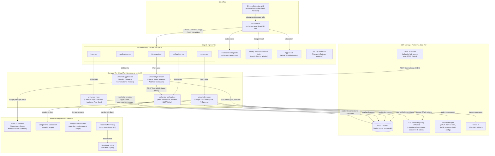
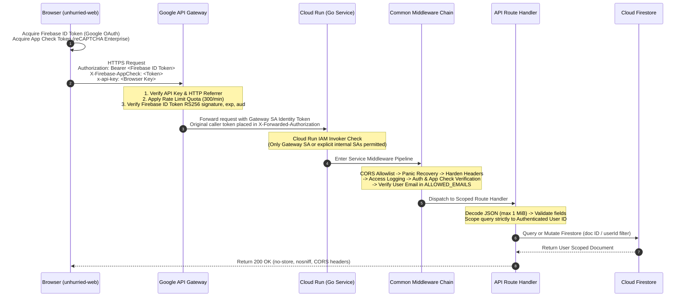
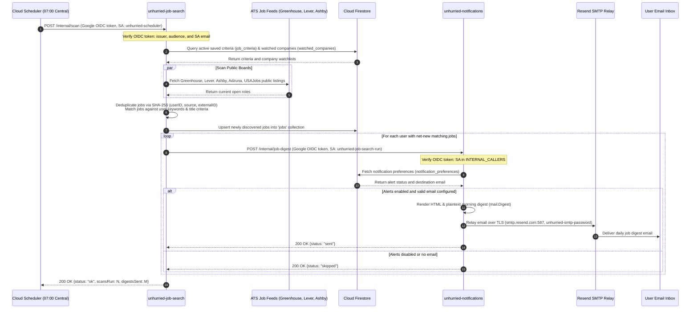
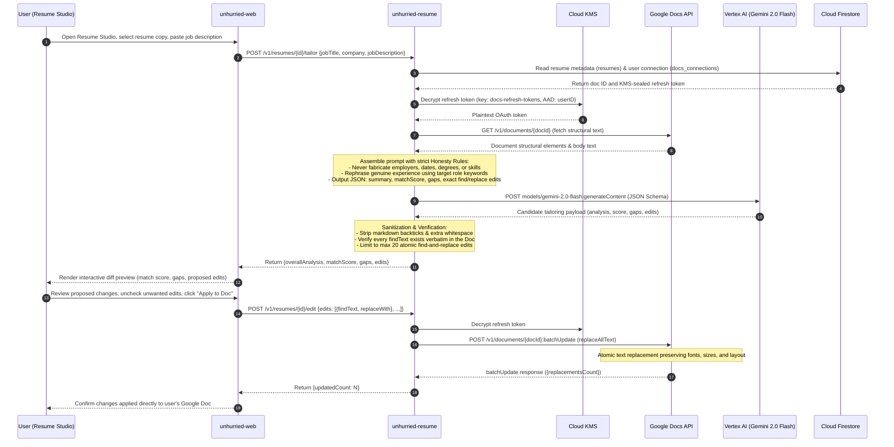
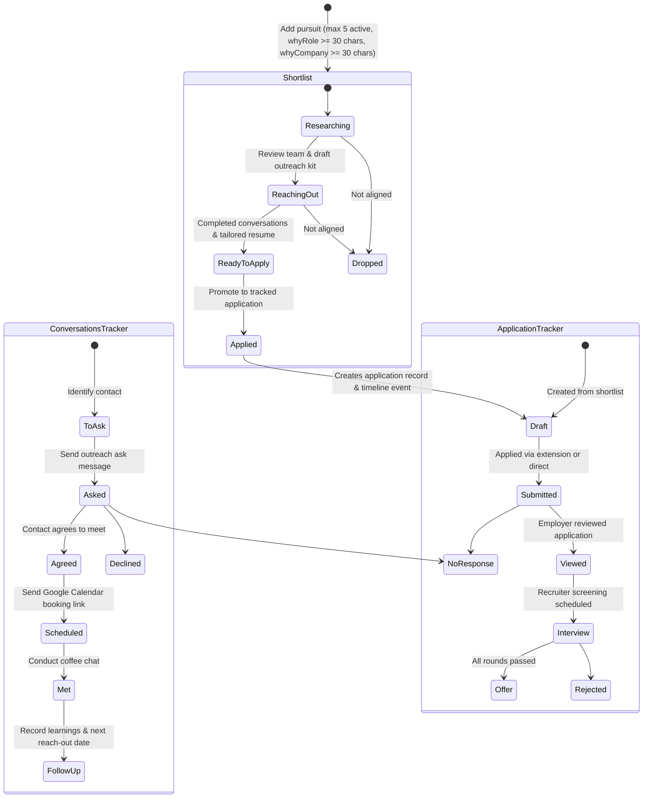
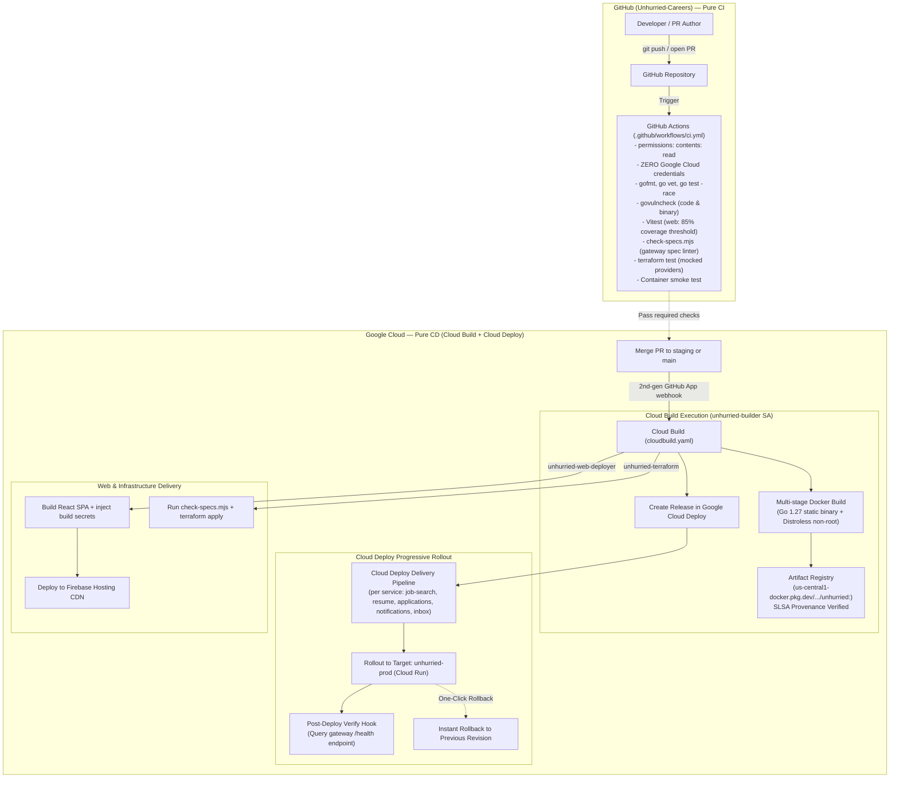

# Architecture

Unhurried is a deliberate, privacy-first job pursuit system built on Google Cloud managed services. Nothing runs on servers the project maintains: the frontend is a single-page application served from Firebase Hosting's global CDN, each backend microservice is a container on Cloud Run that scales to zero, and all persistent state lives in Cloud Firestore with envelope encryption via Cloud KMS.

---

## 1. System Topology

Unhurried consists of five Go microservices, a React 18 TypeScript web application, a Chrome Manifest V3 browser extension, and supporting Google Cloud managed services.



| Tier | Components | Responsibilities |
| --- | --- | --- |
| **Frontend** | `unhurried-web` | React 18 single-page application built with TypeScript and Vite. Deployed to Firebase Hosting (`unhurried-careers.com`). Manages authenticated state, Google Picker, Resume Studio, Application Tracker, and Settings. |
| **Extension** | `unhurried-extension` | Chrome Manifest V3 apply assistant. Communicates exclusively through the active signed-in tab of `unhurried-web` via `window.postMessage`. Detects ATS platforms (Greenhouse, Lever, Ashby, Workday), pre-fills applicant data, and records submissions without storing user credentials or auto-submitting. |
| **API Gateways** | 5 managed Google API Gateways | Validates caller API keys, rate limits client traffic (300 req/min per service), validates Firebase ID tokens (signature, issuer, audience), and invokes Cloud Run backend services via dedicated gateway service accounts. |
| **Compute** | 5 Go Cloud Run services | Containerized Go 1.27 applications (`golang:1.27-alpine` build, `gcr.io/distroless/static-debian13:nonroot` runtime). Each enforces ownership scoping, App Check attestation, user email allowlisting, and specific domain rules. |
| **Data & Secrets** | Firestore, KMS, Secret Manager | Cloud Firestore (Native mode, `us-central1`) for document persistence. Cloud KMS key ring `unhurried` for envelope encryption of external OAuth tokens. Secret Manager for sensitive third-party credentials. |
| **AI & External APIs** | Vertex AI, Google Workspace, Resend | Vertex AI Gemini 2.0 Flash for structured resume tailoring. Google Drive & Docs APIs for document management. Google Calendar API for interview discovery. Resend SMTP for outbound alert delivery. |

---

## 2. Request Lifecycle and Security Defense-in-Depth

Every request from the browser to any backend API undergoes validation across multiple independent security boundaries. Each boundary fails closed:



### Middleware Pipeline Architecture

Each Go microservice constructs its HTTP pipeline using `unhurried-common`:

```
Request ──► httpx.CORS ──► httpx.Recover ──► httpx.Harden ──► httpx.AccessLog ──► auth.Middleware ──► Route Handler
```

1. **`httpx.CORS`**: Rejects unapproved origins with `403 Forbidden`. Only authorized origins (e.g. `https://unhurried-careers.com`) receive CORS response headers.
2. **`httpx.Recover`**: Intercepts unhandled panics, logs stack traces securely, and returns a safe `500 Internal Server Error`.
3. **`httpx.Harden`**: Attaches strict security headers: `X-Content-Type-Options: nosniff`, `Cache-Control: no-store`, `X-Frame-Options: DENY`, `Referrer-Policy: strict-origin-when-cross-origin`.
4. **`httpx.AccessLog`**: Emits structured JSON access logs with request method, path, status, latency, and client IP.
5. **`auth.Middleware`**:
   - Skips authentication only for `GET /health`, `GET /healthz`, and `OPTIONS`.
   - On `/internal/*` endpoints: validates Google OIDC token (`accounts.google.com`, audience `INTERNAL_AUDIENCE`, email in `INTERNAL_CALLERS`).
   - On public `/v1/*` endpoints: validates App Check token, extracts Firebase ID token from `X-Forwarded-Authorization`, verifies RS256 signature against cached Google x509 certificates, and checks that the verified email matches `ALLOWED_EMAILS`.
6. **Route Handler**: Validates request parameters and payload structure (`validate.Errors`), reads the principal from context (`auth.FromContext`), and enforces strict ownership scoping.

---

## 3. Daily Outbound Job Alerts & Scanning Pipeline

Every morning, Cloud Scheduler triggers an automated scan for newly posted jobs across public ATS feeds and user-watched companies. New matching jobs are recorded and emailed in a digest via Resend SMTP.



---

## 4. AI Resume Tailoring Architecture

The Resume Studio allows users to maintain a master resume as a native Google Doc in their personal Google Drive. For each shortlisted pursuit, the user can create an AI-tailored copy optimized for the target job description using Google Cloud Vertex AI (Gemini 2.0 Flash) while strictly enforcing honesty rules.



---

## 5. Applications, Shortlist, and Conversations Subsystem

Unhurried enforces a deliberate, low-volume job search workflow. Users select at most five active roles to pursue at any time, write substantive reasons for pursuing each, reach out to team members for informational conversations, and track interview rounds with preparation checklists.



```mermaid
flowchart LR
  subgraph ExtensionBridge["Chrome Extension Apply Flow"]
    PAGE["Target Job Board<br/>(Greenhouse, Lever, Ashby, Workday)"]
    EXT_POPUP["Extension Popup<br/>(Select Application)"]
    EXT_BG["Extension Background Worker"]
    BRIDGE["bridge.js<br/>(Content Script on web app)"]
    WEB_BRIDGE["extensionBridge.ts<br/>(Unhurried Web App)"]
    APP_API["unhurried-applications<br/>(GET /fill-payload, POST /submit)"]
  end

  PAGE -->|"activeTab"| EXT_POPUP
  EXT_POPUP -->|"relay command"| EXT_BG
  EXT_BG -->|"chrome.tabs.sendMessage"| BRIDGE
  BRIDGE -->|"window.postMessage"| WEB_BRIDGE
  WEB_BRIDGE -->|"authenticated API call"| APP_API
  APP_API -->>|"fill fields"| WEB_BRIDGE
  WEB_BRIDGE -->>|"DOM form input"| PAGE
  PAGE -.->|"user manually clicks submit"| PAGE
  EXT_POPUP -->|"POST /submit with confirmation"| APP_API
```

---

## 6. Google Calendar Interview Detection & Free Slot Proposal

Unhurried connects to Google Calendar with read-only permissions (`calendar.events.readonly`) to help candidates track interviews and generate free meeting slots for recruiters without ever storing raw calendar events.

```mermaid
flowchart TD
  subgraph OAuthConnect["OAuth Connection Lifecycle"]
    U1["User clicks 'Connect Calendar'"] --> CONNECT["POST /v1/calendar/connect"]
    CONNECT --> PKCE["Generate SHA-256 PKCE & state in calendar_oauth_states"]
    PKCE --> GOOG_CONSENT["Redirect to Google OAuth Consent<br/>(calendar.events.readonly)"]
    GOOG_CONSENT --> CALLBACK["POST /v1/calendar/callback {code, state}"]
    CALLBACK --> EXCHANGE["Exchange code for refresh token"]
    EXCHANGE --> SEAL["Cloud KMS Encrypt<br/>(Key: calendar-refresh-tokens, AAD: userId)"]
    SEAL --> SAVE_CONN["Store in calendar_connections<br/>(Sealed token, email, status)"]
  end

  subgraph EventDiscovery["Privacy-First Interview Detection"]
    U2["User views Tracker page"] --> GET_EVENTS["GET /v1/calendar/events?from=&to="]
    GET_EVENTS --> DECRYPT["Cloud KMS Decrypt Refresh Token"]
    DECRYPT --> GCAL_API["Google Calendar API: list events (past 60 to next 60 days)"]
    GCAL_API --> HEURISTICS["Heuristic Classification Engine<br/>- Match recruiter emails & domains<br/>- Video links (Meet, Zoom, Teams)<br/>- Keywords: Interview, Screen, Debrief, Chat"]
    HEURISTICS --> FLAGGED["Return timed events with likelyInterview: true/false<br/>(Events are NEVER stored in Firestore)"]
    FLAGGED --> CONFIRM["User confirms interview link to Application Round<br/>(POST /v1/applications/{id}/rounds/{roundId}/interviews)"]
  end

  subgraph SlotProposals["Free Slot Proposal Engine"]
    U3["User requests interview proposal"] --> PROPOSE["POST /v1/interviews/propose"]
    PROPOSE --> BUSY_TIMES["Compute busy periods from user calendar"]
    BUSY_TIMES --> GEN_SLOTS["Generate 5 one-hour non-overlapping candidate slots<br/>within business hours across upcoming days"]
    GEN_SLOTS --> SAVE_SLOTS["Persist proposed slots in 'interviews' collection"]
    SAVE_SLOTS --> SHARE["Copy formatted availability text with booking link"]
  end
```



---

## 7. CI/CD Architecture (GitHub Actions CI vs. Google Cloud CD)

Unhurried enforces a strict architectural boundary between Continuous Integration and Continuous Delivery:



---

## 8. Data Model & Firestore Persistence

All five backend services utilize Cloud Firestore (Native mode in `us-central1`) for document persistence. Client direct access to Firestore is permanently disabled via security rules (`allow read, write: if false;`), ensuring all data access is mediated through the Go backend services.

| Service | Firestore Collection | Document ID Scheme | Scoped By | Purpose |
| --- | --- | --- | --- | --- |
| **`job-search`** | `job_criteria` | Random UUID (`ids.New()`) | `userId` | User saved job search criteria (titles, locations, keywords, salary) |
| **`job-search`** | `jobs` | SHA-256 of `(userId, source, externalId)` | `userId` | Deduplicated discovered job listings from scrapers |
| **`job-search`** | `watched_companies` | Random UUID (`ids.New()`) | `userId` | Followed companies with ATS platform and board token (max 50) |
| **`resume`** | `resumes` | Random UUID (`ids.New()`) | `userId` | Resumes metadata (title, role, Google Doc ID, match scores) |
| **`resume`** | `docs_connections` | User ID (`userID`) | `userId` | Sealed Google Drive refresh token, folder ID, and master resume ID |
| **`resume`** | `docs_oauth_states` | SHA-256 of state token | — | Pending Google Drive OAuth 2.0 PKCE state verifiers |
| **`applications`**| `pursuits` | Random UUID (`ids.New()`) | `userId` | Shortlisted roles (max 5 active), `whyRole`, `whyCompany`, status |
| **`applications`**| `contacts` | Random UUID (`ids.New()`) | `userId` | Outreach networking contacts per pursuit (max 20 per role) |
| **`applications`**| `conversations` | Random UUID (`ids.New()`) | `userId` | Coffee chats and informational interview records |
| **`applications`**| `conversation_settings` | User ID (`userID`) | `userId` | User Google Calendar booking page link and availability notes |
| **`applications`**| `applications` | Random UUID (`ids.New()`) | `userId` | Tracked job applications (draft, submitted, interview, offer) |
| **`applications`**| `application_events` | Random UUID (`ids.New()`) | `userId` | Audit event timeline for application status changes |
| **`applications`**| `interview_rounds` | Random UUID (`ids.New()`) | `userId` | Interview stages, skills to show/shown, learnings, prep checklist |
| **`notifications`**| `notification_preferences` | User ID (`userID`) | `userId` | Alert preferences, destination email, enabled toggle |
| **`inbox`** | `calendar_connections` | User ID (`userID`) | `userId` | Sealed Google Calendar refresh token, Google email, sync status |
| **`inbox`** | `calendar_oauth_states`| SHA-256 of state token | — | Pending Google Calendar OAuth 2.0 PKCE state verifiers |
| **`inbox`** | `interviews` | Random UUID (`ids.New()`) | `userId` | Proposed and confirmed interview slots |

> [!NOTE]
> Queries against Firestore use equality filters (`Where("userId", "==", userID)`) and sort in Go memory, eliminating the need for composite index maintenance. Every document contains a `userId` field, and foreign lookups return `404 Not Found` rather than `403 Forbidden` to prevent object identifier enumeration.

---

## 9. Technology Stack Summary

| Area | Technology & Tooling | Version / Configuration |
| --- | --- | --- |
| **Frontend** | React, TypeScript, Vite, React Router, Firebase JS SDK | React 18, TypeScript 5, Vite 5, React Router v7, Firebase SDK v13 |
| **Extension** | Vanilla JavaScript, Chrome Extensions Manifest V3 | Manifest V3, content scripts, background service worker |
| **Backend Services** | Go, Standard Library `net/http` | Go 1.23+ modules, Go 1.27 Alpine build, Distroless Debian 13 runtime |
| **AI Engine** | Google Cloud Vertex AI | Gemini 2.0 Flash (`gemini-2.0-flash`), region `us-central1` |
| **Database** | Google Cloud Firestore | Native Mode, delete protection enabled, `us-central1` |
| **Envelope Encryption** | Google Cloud KMS | Key ring `unhurried`, symmetric encryption (`GOOGLE_SYMMETRIC_ENCRYPTION`), 90-day automatic rotation |
| **Email Delivery** | Resend SMTP Relay | Host `smtp.resend.com:587`, STARTTLS, credentials in Secret Manager |
| **Infrastructure** | HashiCorp Terraform | Terraform 1.16, Google & Google-Beta providers ~> 6.0 |
| **CI Platform** | GitHub Actions | Pure CI, `permissions: contents: read`, zero GCP credentials |
| **CD Platform** | Google Cloud Build & Google Cloud Deploy | 2nd-gen GitHub connections, SLSA verified builds, progressive rollouts |
