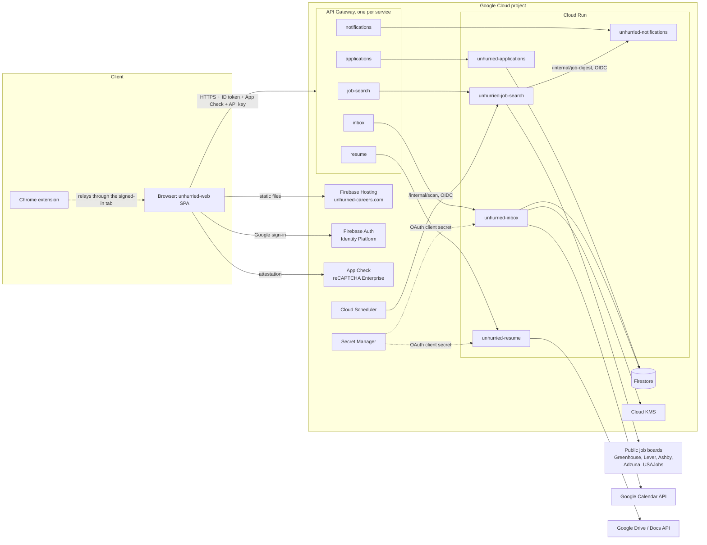
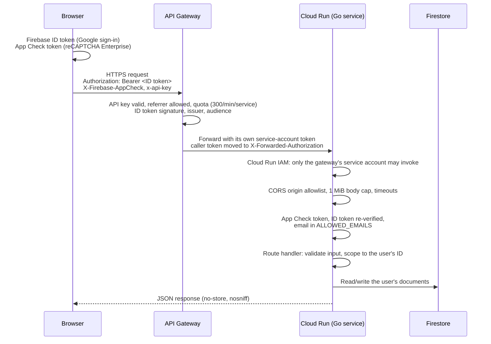
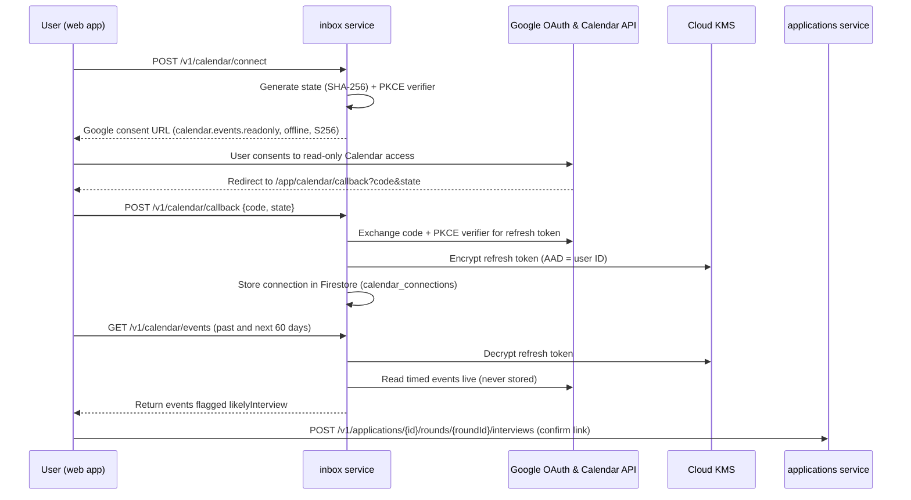

# Architecture

## Overview

Unhurried is a three-tier application on Google Cloud managed services. Nothing runs on servers the project maintains: the frontend is static files on a CDN, each backend service is a container on Cloud Run that scales to zero, and the database is Firestore.

| Tier | Components |
| --- | --- |
| Frontend | `unhurried-web`: React 18 + TypeScript + Vite single-page app on Firebase Hosting. Public homepage at `/`, signed-in app under `/app/*`. `unhurried-extension`: Chrome Manifest V3 apply assistant. |
| Backend | Five Go services (`unhurried-job-search`, `-resume`, `-applications`, `-notifications`, `-inbox`) on Cloud Run, each with its own API Gateway and OpenAPI spec. Shared code in `unhurried-common`. |
| Data | Cloud Firestore (Native mode, `us-central1`, delete protection on). Cloud KMS seals Google Calendar and Google Drive refresh tokens. |

## Request lifecycle

Every call from the web app to an API follows the same path. Each layer rejects the request on its own if its check fails.

The middleware chain in each service is, from outermost: `CORS → Recover → Harden → AccessLog → auth.Middleware → routes` (`unhurried-common/httpx` and `unhurried-common/auth`).

## Service-to-service and scheduled calls

Routes under `/internal/*` are never published on API Gateway; the gateway spec checker fails CI if one appears. Callers reach Cloud Run directly with a Google-signed OIDC token whose audience is `unhurried-internal`:

| Caller | Target | Purpose | Schedule |
| --- | --- | --- | --- |
| Cloud Scheduler (`unhurried-scheduler` SA) | job-search `POST /internal/scan` | Run saved searches | Daily at 07:00 |
| job-search (`unhurried-job-search-run` SA) | notifications `POST /internal/job-digest` | Email each user the new jobs their search criteria matched | After each scheduled scan |

Each target allows only the listed caller twice over: Cloud Run's `roles/run.invoker` binding, and the service's own check of the token's audience and caller email (`INTERNAL_CALLERS`). Services with no listed caller (`applications`, `inbox`, `resume`) reject every internal call.

Job-search calls notifications through Cloud Run's deterministic URL (`https://unhurried-notifications-<project-number>.<region>.run.app`), which avoids a Terraform dependency cycle between services. Notifications sends the email through the SMTP relay set by `smtp_host`; the relay password is in Secret Manager (`unhurried-smtp-password`), readable only by the notifications service account.

## Google Calendar interview integration

## Environments

Each environment is a separate Google Cloud project created from the same Terraform (`unhurried-infra/envs/<env>`), deployed from its own branch.

| | Production | Staging |
| --- | --- | --- |
| Branch | `main` | `staging` |
| Project | `project-191091d4-b2e5-4294-9e7` (number 954425970179) | Not created yet (`STAGING_PROJECT_ID` placeholder) |
| Web | https://unhurried-careers.com, `www` redirects; Hosting site `unhurried-careers` | https://unhurried-careers-staging-web.web.app |
| Sign-in domain | `unhurried-careers.firebaseapp.com` | `unhurried-careers-staging-web.firebaseapp.com` |
| Terraform state | `gs://project-191091d4-b2e5-4294-9e7-tfstate/prod` | `gs://<project>-tfstate/staging` |
| Settings | `envs/prod/settings.auto.tfvars` | `envs/staging/settings.auto.tfvars` |

`unhurried-careers.web.app`, Firebase's built-in address for the production site, still serves the same content; it cannot be removed.

## Cloud resources per environment

| Resource | Details |
| --- | --- |
| Cloud Run services | 5, region `us-central1`, 0 to 10 instances, 1 vCPU and 512 MiB each, each running as its own `<service>-run` service account |
| API Gateway | One API, config, and gateway per service, each with its own `<service>-gw` service account (the only Cloud Run invoker besides internal callers) |
| Firestore | `(default)` database, Native mode, delete protection enabled |
| Cloud Scheduler | `unhurried-job-search-scan` (`0 7 * * *`, daily), time zone America/Chicago |
| Pub/Sub | Topics `unhurried-job-found`, `-resume-ready`, `-application-updated`, `-interview-requested`, `-notify-user` (created; not yet used by code) |
| Artifact Registry | Docker repository `unhurried` |
| Cloud KMS | Key ring `unhurried`, keys `calendar-refresh-tokens` (inbox only) and `docs-refresh-tokens` (resume only), 90-day rotation, destroy-protected |
| Secret Manager | `unhurried-google-oauth-client-secret`, `unhurried-web-build-config`, `unhurried-smtp-password` (alert emails; notifications only), placeholders for Adzuna |
| Identity Platform | Google provider only; email/password and phone disabled; signup switch; user deletion disabled |
| Firebase | Web app, App Check (reCAPTCHA Enterprise), Hosting site and custom domains |
| API key | `unhurried-web` browser key, restricted to the site's domains and the five gateways |
| CD (Cloud Build + Cloud Deploy) | 2nd-gen GitHub connection & branch deploy triggers, Cloud Deploy custom target + 5 delivery pipelines, `<project>-cicd-artifacts` bucket, `unhurried-builder`, `unhurried-deployer`, `unhurried-web-deployer`, `unhurried-terraform` |

## Data model and persistence

Shared types live in `unhurried-common/models`. Where data is stored today:

| Data | Service | Storage | Firestore collection |
| --- | --- | --- | --- |
| Shortlist (pursuits) | applications | Firestore | `pursuits` |
| Outreach contacts | applications | Firestore | `contacts` |
| Conversations (person, company, ask, meeting, learnings, reach-out date) | applications | Firestore | `conversations` |
| Conversation settings (booking page link, availability) | applications | Firestore | `conversation_settings` (document ID = user ID) |
| Applications | applications | Firestore | `applications` |
| Application timeline | applications | Firestore | `application_events` |
| Interview rounds (interviews, skills, learnings, notes, prep) | applications | Firestore | `interview_rounds` |
| Google Calendar connections (sealed refresh token, email, status) | inbox | Firestore | `calendar_connections` (document ID = user ID) |
| Pending Google Calendar sign-ins | inbox | Firestore | `calendar_oauth_states` (document ID = SHA-256 of the state) |
| Resume records (title, role, Google Doc ID and link, source) | resume | Firestore | `resumes` |
| Google Drive connections (sealed refresh token, folder, master resume) | resume | Firestore | `docs_connections` (document ID = user ID) |
| Pending Google Drive sign-ins | resume | Firestore | `docs_oauth_states` (document ID = SHA-256 of the state) |
| Resume documents themselves | — | The user's Google Drive, folder "Unhurried resumes" | — |
| Search criteria, found jobs, watchlist | job-search | In memory | — |
| Email alert preferences | notifications | In memory | — |
| Interview slots | inbox | In memory | — |

In-memory data is lost when a Cloud Run instance stops; see [Implementation status](status.md). Firestore queries use equality filters only and sort in the service, so no composite indexes are required. Every document carries a `userId`, and every user-facing read checks it.

Key fields:

- **Pursuit**: job, company, title, URL, `whyRole`, `whyCompany` (each at least 30 characters), `fitNotes`, status (`researching`, `reaching_out`, `ready_to_apply`, `applied`, `dropped`), linked application.
- **Application**: company, role, `origin` (`shortlist` or `""`), status (`draft`, `submitted`, `viewed`, `interview`, `rejected`, `offer`, `no_response`), ATS, tracking portal URL and username, `submittedAt`, `lastEventAt`.
- **Conversation**: company, optional linked pursuit, person (name, title, email, LinkedIn), `message` asking for their time, `minutes` asked for, `meetingAt`, status (`to_ask`, `asked`, `agreed`, `scheduled`, `met`, `declined`, `no_response`), `learnings`, `nextReachOut` (date) and note.
- **Round**: application ID, position, name, status (`upcoming`, `awaiting`, `passed`, `not_passed`, `cancelled`), `interviews` (calendar event ID, title, start/end), `skillsToShow`, `skillsShown`, `learnings`, `notes`, `prep`.
- **ApplicationEvent**: kind (a status), source (`extension`, `you`, ...), summary, time.

## Technology

| Area | Choice |
| --- | --- |
| Backend language | Go: modules require 1.23 (1.26 for applications and inbox, which use Google Cloud client libraries); images are built with Go 1.27. Standard library `net/http` routing |
| Backend images | `golang:1.27-alpine` build, `gcr.io/distroless/static-debian13:nonroot` runtime, static binary |
| Frontend | React 18, TypeScript 5, Vite 5, react-router-dom 7, Firebase JS SDK 13 |
| Extension | Plain JavaScript, Manifest V3, built with a small Node script |
| Tests | Go `testing` with `httptest`; Vitest + Testing Library (web, jsdom); Vitest (extension); Terraform `terraform test` with mocked providers |
| Infrastructure | Terraform 1.16, `hashicorp/google` and `google-beta` ~> 6.0, GCS backend |
| CI/CD | GitHub Actions (pure CI on PRs, pushes & daily cron) + Google Cloud Build & Google Cloud Deploy (pure CD on `staging`/`main`) |
