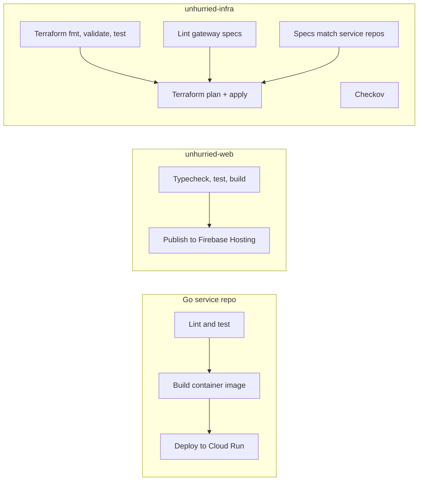

# CI/CD

Every repository has one GitHub Actions workflow, `.github/workflows/ci.yml`. It runs checks on every push and pull request, and deploys when a push lands on an environment branch. There is no other deployment path: Cloud Build is no longer used, and manual deploys are only for bootstrapping.

## Branches and environments

| Branch | Deploys to | Status |
| --- | --- | --- |
| `main` | Production: project `project-191091d4-b2e5-4294-9e7`, https://unhurried-careers.com | Active |
| `staging` | Staging: its own project, https://unhurried-careers-staging-web.web.app | Branches exist in all repos; deploy jobs are switched off until the staging project exists |
| anything else / pull requests | Nothing (checks only) | |

Work flows `feature branch → staging → main`. Promote to production by merging `staging` into `main` in each repository that changed.

The organization is on GitHub's free plan, so private repositories cannot use deployment environments, required reviewers, or branch protection. The separation between environments is enforced on the Google Cloud side instead (see [Authentication to Google Cloud](#authentication-to-google-cloud)).

## What each pipeline does



### Go services (job-search, resume, applications, notifications, inbox)

| Job | Steps |
| --- | --- |
| **Lint and test** | Check out the service and `unhurried-common` (matching branch) · `gofmt -l` must be empty · `go vet` · `go test -race` with coverage (summary on the run page, report as an artifact) · `govulncheck` on the source |
| **Build container image** | `docker build` from the workspace root (both checkouts) · smoke test: the image runs as `nonroot:nonroot`, `/health` answers with `AUTH_DEV_BYPASS`, and the image refuses to start without auth configuration · `govulncheck -mode=binary` on the shipped binary, which catches standard library issues in the Go version the Dockerfile uses |
| **Deploy** (pushes to `main`) | Sign in to Google Cloud with the branch's identity · build and push `us-central1-docker.pkg.dev/<project>/unhurried/<service>:<commit SHA>` · `gcloud run services update <service> --image ...` |

The deploy changes only the image. Everything else about the service (environment variables, secrets, scaling, service account) is owned by Terraform, which ignores the image after creating the service. `gcloud run services update` waits for the new revision to become ready and fails the job if it does not, leaving the previous revision serving.

### unhurried-common

Lint and test only: gofmt, vet, race tests with coverage, govulncheck. A daily scheduled run in every Go repository catches breaking changes in `unhurried-common`. A change to common reaches production when each dependent service is next deployed (push or re-run of its pipeline).

### unhurried-web

| Job | Steps |
| --- | --- |
| **Typecheck, test, build** | `npm ci` · `tsc -b` · Vitest with coverage thresholds (85% lines, 75% branches) and a summary table · production build · `npm audit --omit=dev --audit-level=high` |
| **Deploy** (pushes to `main`) | Sign in as `unhurried-web-deployer` · read `unhurried-web-build-config` from Secret Manager into `VITE_*` variables (API keys masked in logs) · build · verify the bundle contains this environment's project ID and inbox gateway and no `localhost` URLs · `firebase target:apply` the site from the config · `firebase deploy --only hosting:web` with the commit SHA as the release message |

The build configuration is written by Terraform on every apply, so gateway URLs, the Firebase app config, and the browser API key never need to be copied into GitHub.

### unhurried-extension

Unit tests with a 90% line-coverage threshold, then `npm run build` and upload of `dist/` as the `unhurried-extension` artifact. The extension is loaded unpacked in Chrome; there is no store publishing step.

### unhurried-infra

| Job | Steps |
| --- | --- |
| **Terraform fmt, validate, test** | `terraform fmt -check -recursive` · for every module and both environments: `init -backend=false`, `validate`, `test` (mocked providers, no credentials) |
| **Lint gateway specs** | `tools/check-specs.mjs`: Swagger 2.0; backend placeholder with `APPEND_PATH_TO_ADDRESS`; Firebase issuer/audience bound to the project; API key in a header; global security requires both; quota limits defined and every secured operation has a quota cost; only `OPTIONS` and `/health` skip auth; every path has an `OPTIONS` preflight; path parameters declared; unique operation IDs; no `/internal/*` paths |
| **Gateway specs match service repos** | For each service, `gateway-specs/<service>.yaml` must equal that repository's `openapi.yaml` on the matching branch |
| **Checkov** | Terraform security scan, informational (soft fail) |
| **Apply** (pushes to `main`) | Requires the three checks above · sign in as `unhurried-terraform` · `terraform init` with the environment's state bucket and prefix · `plan -out` (summary on the run page) · `apply` the saved plan; both use a 5-minute state-lock timeout |

The OAuth client secret, the only secret Terraform needs, comes from the `PRODUCTION_GOOGLE_OAUTH_CLIENT_SECRET` (or `STAGING_...`) repository secret; the job fails early with a clear message if it is missing.

### Concurrency

- Pull-request runs for the same branch cancel each other.
- Push runs never cancel each other: a new push waits, so a running `terraform apply` or rollout is never interrupted (which could leave a stuck state lock).
- Deploy jobs also have a per-environment concurrency group with `cancel-in-progress: false`.

### Cross-repository checkouts

Go pipelines check out `unhurried-common`, and the infra pipeline checks out each service's `openapi.yaml`. Pull requests and pushes compare against `main` when the base or branch is `main`, and `staging` otherwise. Because the repositories are private, these checkouts use the `UNHURRIED_REPOS_TOKEN` repository secret (a token with read access to the organization's repositories), falling back to the job's own token.

## Authentication to Google Cloud

Pipelines use **Workload Identity Federation**: GitHub issues a short-lived OIDC token for the job, Google exchanges it for short-lived credentials of a service account. No service account key exists anywhere.

`unhurried-infra/modules/cicd` creates, in each environment's project:

| Resource | Rule |
| --- | --- |
| Pool `github`, provider `github` | Accepts only tokens from `token.actions.githubusercontent.com` whose `repository_owner_id` is `350891080` (the Unhurried-Careers organization, by numeric ID so a different organization taking over the name cannot deploy) **and** whose `ref` is `refs/heads/<deploy_branch>` (`main` for production, `staging` for staging) |
| `unhurried-deployer` | Impersonable only by the five service repositories. Can push to the `unhurried` Artifact Registry repository, has `roles/run.developer` on each of the five Cloud Run services only, and `roles/iam.serviceAccountUser` on each service's runtime account (so new revisions keep running as that account) |
| `unhurried-web-deployer` | Impersonable only by `unhurried-web`. Firebase Hosting admin and log writer; can read only the `unhurried-web-build-config` secret |
| `unhurried-terraform` | Impersonable only by `unhurried-infra`. Project owner, because Terraform manages IAM |

So a workflow on any branch other than the environment's branch, or in any repository other than the expected one, cannot obtain credentials for that environment. Deploy jobs request `id-token: write`; every other job runs with `contents: read` only.

Each workflow maps the branch to its project in a `Select environment` step:

```bash
case "$GITHUB_REF_NAME" in
  staging) project=STAGING_PROJECT_ID             number=STAGING_PROJECT_NUMBER ;;
  main)    project=project-191091d4-b2e5-4294-9e7 number=954425970179 ;;
esac
# provider = projects/$number/locations/global/workloadIdentityPools/github/providers/github
```

## Repository secrets

| Repository | Secret | Used for |
| --- | --- | --- |
| unhurried-infra | `PRODUCTION_GOOGLE_OAUTH_CLIENT_SECRET` | Terraform's `google_oauth_client_secret` |
| unhurried-infra | `STAGING_GOOGLE_OAUTH_CLIENT_SECRET` | Same, for staging (to be added) |
| all Go repos, infra | `UNHURRIED_REPOS_TOKEN` | Checking out sibling private repositories |

## Runbooks

### Release to production

1. Merge the change into `staging` in each affected repository (once staging deploys are on, verify it there).
2. Merge `staging` into `main`. Order matters only when changes depend on each other: infrastructure first (new environment variables, secrets, routes), then services, then web.
3. Watch the runs: `gh run list -R Unhurried-Careers/<repo> -b main`. Each deploy job writes what it deployed to the run summary.

API changes touch three places that must agree: the service's `openapi.yaml`, `unhurried-infra/gateway-specs/<service>.yaml` (the spec-sync check enforces equality), and the web client in `src/api.ts`.

### Roll back

| What | How |
| --- | --- |
| A service | Send traffic back to the previous revision: `gcloud run services update-traffic <service> --to-revisions=<revision>=100 --region us-central1 --project <project>`, or re-run the deploy job of an earlier commit, then revert the commit so the next push does not redeploy it |
| The web app | Firebase console → Hosting → release history → roll back, or `npx firebase hosting:rollback`; then revert the commit |
| Infrastructure | Revert the commit on `main`; the pipeline plans and applies the previous configuration. Firestore and the Gmail KMS key are protected from deletion |

### Turn on staging

Covered step by step in `unhurried-infra/README.md` ("Turning on staging"). In summary: create the project and link billing; enable APIs; create the versioned `<project>-tfstate` bucket; configure the project's Google Auth Platform (branding, test users, `gmail.readonly` scope, Web client with the redirect URIs from `terraform output oauth_redirect_uris`); create a reCAPTCHA Enterprise key; fill `envs/staging/settings.auto.tfvars`; seed the first images; apply once by hand (this creates the pipeline identities); add the `STAGING_GOOGLE_OAUTH_CLIENT_SECRET` secret; and in every repository's `ci.yml` replace the `STAGING_PROJECT_ID`/`STAGING_PROJECT_NUMBER` placeholders and add `|| github.ref_name == 'staging'` to the deploy job's `if`.

### Add a service

1. Create the repository from an existing service; `.local-run/go-service-ci.yml.tmpl` is the pipeline template (replace `__SVC__`).
2. Add it to `local.services` (and `internal_callers` if it has internal routes) in both `envs/*/main.tf`, and copy its spec to `gateway-specs/`.
3. Add it to the spec-sync matrix in the infra workflow and to the web build config if the frontend calls it.
4. Seed its first image, apply Terraform (this also grants the deployer access to it), then push.

### Rotate the OAuth client secret

Create a new secret on the client in Google Auth Platform, put it in `envs/prod/terraform.tfvars` and the `PRODUCTION_GOOGLE_OAUTH_CLIENT_SECRET` repository secret, apply (this updates Identity Platform and the Secret Manager version the inbox reads), redeploy the inbox (it reads `latest` on start), then delete the old secret.

### Troubleshooting

| Symptom | Cause |
| --- | --- |
| `google-github-actions/auth` fails with permission denied | The workflow ran on a branch or in a repository the environment's provider or service account does not trust; or the pool was just created (allow a few minutes) |
| Checkout of `unhurried-common` fails | The matching branch does not exist in common, or `UNHURRIED_REPOS_TOKEN` lacks access |
| Spec-sync fails | A service's `openapi.yaml` changed without copying it to `unhurried-infra/gateway-specs/` (or the other way round) |
| `terraform apply` waits on the state lock | Another apply is running; if a run was killed, unlock with `terraform force-unlock <id>` after confirming nothing is running |
| Gateway configs replaced on every apply | Spec files with different line endings; the service module normalizes CRLF, so this should not recur |
| Web deploy fails the bundle check | The build config secret is missing a value, or Terraform has not been applied in that environment |
