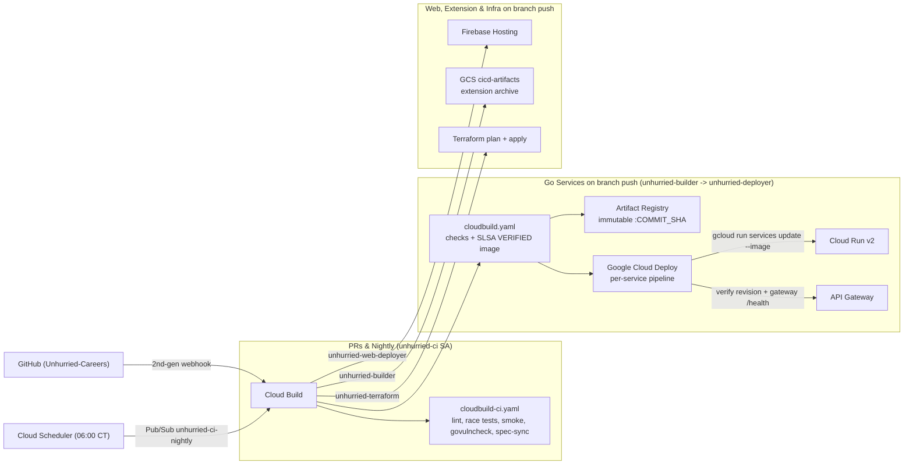

# CI/CD

Every code repository runs its entire CI/CD pipeline natively inside Google Cloud using **Cloud Build** (2nd-generation GitHub connection and triggers), **Google Cloud Deploy** (Cloud Run continuous delivery, post-deploy verification, approval gates, and rollbacks), **Artifact Registry**, **Secret Manager**, and **Cloud Scheduler**. GitHub holds source code and displays Cloud Build check statuses on pull requests and commits; zero secrets or workflows live in GitHub Actions.

## Branches and environments

| Branch | Deploys to | Status |
| --- | --- | --- |
| `main` | Production: project `project-191091d4-b2e5-4294-9e7`, https://unhurried-careers.com (`production` Cloud Deploy target) | Active |
| `staging` | Staging: its own project, https://unhurried-careers-staging-web.web.app (`staging` Cloud Deploy target) | Branches and `envs/staging` ready; turns on as soon as the staging GCP project is created and applied |
| pull requests targeting `deploy_branch` | Nothing (`cloudbuild-ci.yaml` checks only, running as `unhurried-ci`) | Active |

Work flows `feature branch → staging → main`. Promote to production by merging `staging` into `main` in each repository that changed.

Because each GCP project runs its own Terraform-provisioned Cloud Build triggers locked to `^<deploy_branch>$` (`^main$` in production, `^staging$` in staging), environment isolation is enforced inside Google Cloud IAM and trigger bindings rather than GitHub plan features. Optional manual promotion gates are available directly in Google Cloud Deploy via `require_deploy_approval = true`.

## Architecture



## Pipeline files per repository

- **`cloudbuild-ci.yaml`** (Go services, `unhurried-web`, `unhurried-extension`, `unhurried-infra`): check-only pipeline invoked on pull requests and daily 06:00 Central scheduled scans under the read-only `unhurried-ci` service account. Separating `cloudbuild-ci.yaml` from `cloudbuild.yaml` ensures PR builds never declare top-level `images:` or `availableSecrets:` that `unhurried-ci` is intentionally forbidden from accessing.
- **`cloudbuild.yaml`**: full check-and-deploy pipeline invoked on pushes to the environment's `deploy_branch` (`unhurried-common` uses a single `cloudbuild.yaml` for both PRs and pushes since it only runs checks).
- Every Cloud Build configuration sets `options.logging: CLOUD_LOGGING_ONLY` (required for custom least-privilege trigger service accounts) and `options.substitutionOption: ALLOW_LOOSE`.

### Go services (`job-search`, `resume`, `applications`, `notifications`, `inbox`)

| Stage | Steps |
| --- | --- |
| **Prepare workspace** | Move the checked-out service into `/workspace/<service>` and clone `unhurried-common` (`main` when targeting `main`, `staging` otherwise) into `/workspace/unhurried-common` using a short-lived token minted from the Cloud Build v2 connection |
| **Lint, test, vulncheck** | `gofmt -l` must be empty · `go vet ./...` · `go test -race -covermode=atomic -coverpkg=./... -coverprofile=coverage.out ./...` · coverage summary logged · `govulncheck` on source |
| **Build & smoke test** | `docker build` from `/workspace` · verify image runs as `nonroot:nonroot` · verify container refuses to start without `FIREBASE_PROJECT_ID` / `ALLOWED_EMAILS` · start container on `--network=cloudbuild` with `AUTH_DEV_BYPASS=true` and verify `http://smoke:8080/health` · extract `/server` and run `govulncheck -mode=binary` |
| **Push & Cloud Deploy release** (`cloudbuild.yaml` only) | Push `us-central1-docker.pkg.dev/<project>/unhurried/<service>:<COMMIT_SHA>` with `requestedVerifyOption: VERIFIED` (SLSA provenance) · create immutable Cloud Deploy release `rel-<SHORT_SHA>-<BUILD_ID_PREFIX>` on the service's delivery pipeline |
| **Cloud Deploy rollout & verify** | Custom target `cloud-run-image` validates `expectedService`, runs `gcloud run services update <service> --image <sha-image>` as `unhurried-deployer`, and runs a `VERIFY` job checking both the Cloud Run ready revision and `https://<gateway_hostname>/health` |

Why a Cloud Deploy **Custom Target Type** (`cloud-run-image`) instead of the built-in Cloud Run target? Standard Cloud Deploy Cloud Run targets execute `gcloud run services replace` from a rendered YAML manifest, which would overwrite or revert Terraform-owned environment variables (`ALLOWED_EMAILS`, `APPCHECK_REQUIRED`, `KMS_KEY_NAME`), Secret Manager bindings, and `custom_audiences`. Our `cloud-run-image` custom target updates **only** `--image`, matching `modules/service`'s `lifecycle.ignore_changes` while retaining Cloud Deploy's release history, approval gates, verification phase, and one-click rollbacks.

### `unhurried-common`

Runs `gofmt -l`, `go vet ./...`, `go test -race -covermode=atomic -coverprofile=coverage.out ./...`, coverage summary, and `govulncheck` under `unhurried-ci` on pull requests and pushes. Daily `06:00 America/Chicago` scheduled triggers across all five Go services test against the latest `unhurried-common` on `deploy_branch`.

### `unhurried-web`

| Pipeline | Steps |
| --- | --- |
| **`cloudbuild-ci.yaml`** (PRs) | `npm ci` · `npm run typecheck` · `npm run test:coverage` (85% lines, 75% branches) + coverage table · test production build · `npm audit --omit=dev --audit-level=high` |
| **`cloudbuild.yaml`** (branch push) | Runs all checks above · injects `unhurried-web-build-config` from Secret Manager via `availableSecrets` + `_CANONICAL_ORIGIN` · builds `dist/` without leaking `WEB_BUILD_CONFIG` to logs · verifies `dist/assets` contains `VITE_FIREBASE_PROJECT_ID` and `VITE_INBOX_API` and zero `localhost:80xx` URLs · publishes via `npx firebase target:apply` and `npx firebase deploy --only hosting:web --message "$COMMIT_SHA"` as `unhurried-web-deployer` |

### `unhurried-extension`

- **`cloudbuild-ci.yaml`** (PRs): `npm ci`, `npm run test:coverage` (90% line threshold), `npm run build`, and Manifest V3 assertion on `dist/manifest.json`.
- **`cloudbuild.yaml`** (branch push): runs the same checks and archives `unhurried-extension-${COMMIT_SHA}.tar.gz` to `gs://<project>-cicd-artifacts/extension/` via Cloud Build `artifacts.objects`.

### `unhurried-infra`

| Stage | Steps |
| --- | --- |
| **Terraform fmt, validate, test** | `terraform fmt -check -recursive -diff` · for all 8 modules (`service`, `data`, `auth`, `hosting`, `google_oauth`, `docs`, `mail`, `cicd`) and both environments (`envs/staging`, `envs/prod`): `init -backend=false`, `validate`, `test` (mocked providers, no credentials) |
| **Lint gateway specs** | `tools/check-specs.mjs` validates Swagger 2.0, backend addressing, Firebase auth + API key requirements, quotas, CORS `OPTIONS` preflights, and absence of `/internal/*` |
| **Gateway spec sync** | Sparse-clones `openapi.yaml` from all 5 service repos via Cloud Build v2 `accessReadToken` and diffs against `gateway-specs/*.yaml` |
| **Checkov** | Informational Terraform security scan (`--soft-fail`) |
| **Plan & apply** (`cloudbuild.yaml` only) | Runs as `unhurried-terraform` · reads `unhurried-gmail-oauth-client-secret` (required) and `unhurried-smtp-password` (optional) from Secret Manager into an isolated step volume · `terraform init -reconfigure` against `gs://<project>-tfstate` · `plan -lock-timeout=10m -out=tfplan` · `apply -lock-timeout=10m tfplan` |

## Least-privilege identities & zero GitHub secrets

`unhurried-infra/modules/cicd` (plus `modules/hosting`) provisions five isolated service accounts per environment:

| Service account | Used by | Permissions |
| --- | --- | --- |
| `unhurried-ci` | All `*-pr` triggers, `unhurried-common-push`, and `*-nightly` triggers | `roles/logging.logWriter` and `roles/cloudbuild.readTokenAccessor` on the GitHub connection only. Cannot push images, read secrets, touch state, or deploy |
| `unhurried-builder` | `<service>-deploy` and `unhurried-extension-package` triggers | `roles/logging.logWriter`, `roles/cloudbuild.readTokenAccessor`, `roles/artifactregistry.writer` on `unhurried`, `roles/storage.objectAdmin` on `<project>-cicd-artifacts`, `roles/clouddeploy.releaser`, and `iam.serviceAccountUser` on `unhurried-deployer`. Cannot modify Cloud Run directly |
| `unhurried-deployer` | Google Cloud Deploy `RENDER`, `DEPLOY`, and `VERIFY` jobs | `roles/clouddeploy.jobRunner`, `roles/artifactregistry.reader` on `unhurried`, `roles/storage.objectAdmin` on `<project>-cicd-artifacts`, `roles/run.developer` on each listed Cloud Run service only, and `iam.serviceAccountUser` on each service's `<service>-run` runtime SA |
| `unhurried-web-deployer` | `unhurried-web-deploy` trigger | `roles/firebasehosting.admin`, `roles/logging.logWriter`, and `roles/secretmanager.secretAccessor` on `unhurried-web-build-config` only |
| `unhurried-terraform` | `unhurried-infra-apply` trigger | `roles/owner`, `roles/logging.logWriter`, and `roles/cloudbuild.readTokenAccessor` |

### Cross-repository checkouts without PATs

No Personal Access Token (`UNHURRIED_REPOS_TOKEN`) exists anywhere. When Go builds need `unhurried-common` or `unhurried-infra` needs each service's `openapi.yaml`, the build step calls `POST https://cloudbuild.googleapis.com/v2/.../repositories/<repo>:accessReadToken` using its GCP service account token to obtain a short-lived, read-only GitHub App token and passes it to `git clone` via a transient `http.https://github.com/.extraheader` header (never written to `.git/config` or build logs).

### Fork pull-request protection

Every `*-pr` trigger sets `comment_control = "COMMENTS_ENABLED_FOR_EXTERNAL_CONTRIBUTORS_ONLY"`, so untrusted pull requests from external forks cannot execute builds until a repository collaborator comments `/gcbrun`.

## Runbooks

### One-time bootstrap of the GitHub connection in an environment

Google Cloud Build's 2nd-generation GitHub connection requires a one-time OAuth / GitHub App installation handshake on the `Unhurried-Careers` GitHub organization:

1. Apply Terraform first with `github_connection_ready = false` in `envs/<env>/settings.auto.tfvars` (or `-var="github_connection_ready=false"`):
   ```bash
   cd unhurried-infra/envs/prod
   terraform apply -var="github_connection_ready=false"
   ```
   This enables the Cloud Build / Cloud Deploy APIs, creates the service accounts, Cloud Deploy pipelines, and `google_cloudbuildv2_connection.github`.
2. Inspect `terraform output cicd` — `github_connection_state` displays `stage = "PENDING_USER_OAUTH"` (or `PENDING_INSTALL_APP`) along with an `action_uri` link (also reachable in Google Cloud Console → **Cloud Build → Repositories → 2nd gen**).
3. Open `action_uri` once as an `Unhurried-Careers` GitHub org admin to authorize the Google Cloud Build GitHub App for the organization's repositories. (`lifecycle.ignore_changes = [github_config]` ensures Terraform preserves the credential Google Cloud writes back.)
4. Set `github_connection_ready = true` (the default) and run `terraform apply` once more. Terraform links all 9 repositories and provisions all PR, deploy, and nightly Cloud Build triggers.

### Release to production

1. Merge feature branches into `staging` and verify staging builds/rollouts.
2. Merge `staging` into `main`. When changes span repositories, merge in order: `unhurried-common` → Go service repos → `unhurried-infra` → `unhurried-web` (so `unhurried-infra`'s `verify-gateway-spec-sync` step sees the updated `openapi.yaml` on `main`).
3. Watch builds and rollouts in Google Cloud Console (**Cloud Build → History** and **Cloud Deploy → Delivery pipelines**) or via CLI:
   ```bash
   gcloud builds list --region=us-central1 --project=project-191091d4-b2e5-4294-9e7 --limit=10
   gcloud deploy rollouts list --delivery-pipeline=unhurried-inbox --release=- --region=us-central1 --project=project-191091d4-b2e5-4294-9e7
   ```
4. If `require_deploy_approval = true` is enabled on the environment, approve pending Cloud Deploy rollouts in the Cloud Deploy console or via `gcloud deploy rollouts approve <rollout> --delivery-pipeline=<service> --release=<release> --region=us-central1`.

### Roll back

| What | How |
| --- | --- |
| A Go service | In **Google Cloud Deploy → Delivery pipelines → `<service>`**, click **Roll back** on the target (or run `gcloud deploy targets rollback production --delivery-pipeline=<service> --region=us-central1 --project=<project>`). Cloud Deploy rolls out the previous verified SHA image and re-runs health verification; then revert the commit on `main` |
| The web app | Firebase Console → Hosting → release history → Roll back (or `npx firebase hosting:rollback`), then revert the commit on `main` |
| Infrastructure | Revert the commit on `main`; `unhurried-infra-apply` plans and applies the previous configuration. Firestore and KMS keys have deletion protection |

### Turn on staging

Covered in `unhurried-infra/README.md`: create the staging GCP project, link billing, enable prerequisite APIs, create the versioned `<project>-tfstate` bucket, configure Google Auth Platform + reCAPTCHA Enterprise, fill `envs/staging/settings.auto.tfvars` and local `envs/staging/terraform.tfvars`, seed initial service images, complete the 2-step GitHub connection bootstrap above, and push to `staging`. No code or pipeline YAML edits are needed in any repository because triggers pass project/branch substitutions automatically.

### Add a service

1. Create the repository from an existing service and render `cloudbuild-ci.yaml` and `cloudbuild.yaml` from `.local-run/go-service-cloudbuild-ci.yaml.tmpl` and `.local-run/go-service-cloudbuild.yaml.tmpl` (replacing `__SVC__`).
2. Add the service to `local.services` (and `local.internal_callers` if needed) in `envs/prod/main.tf` and `envs/staging/main.tf`, and copy its `openapi.yaml` into `unhurried-infra/gateway-specs/`.
3. Add the service pair to `verify-gateway-spec-sync` in `unhurried-infra/cloudbuild-ci.yaml` and `unhurried-infra/cloudbuild.yaml`, and add its `VITE_*_API` entry to `local.web_build_config` if called from `unhurried-web`.
4. Seed its initial image in Artifact Registry and apply Terraform (`module.cicd` automatically links the repository, grants IAM, and creates its PR, deploy, nightly triggers, and Cloud Deploy delivery pipeline).

### Rotate the OAuth client secret

1. Create a new client secret on the Web OAuth client in Google Auth Platform.
2. Update `envs/prod/terraform.tfvars` locally (or add a new version directly to `unhurried-gmail-oauth-client-secret` in Secret Manager: `printf '%s' "$NEW_SECRET" | gcloud secrets versions add unhurried-gmail-oauth-client-secret --data-file=- --project=project-191091d4-b2e5-4294-9e7`) and run `unhurried-infra-apply` (updates Identity Platform and Secret Manager).
3. Trigger a rollout of `unhurried-inbox` and `unhurried-resume` so new Cloud Run revisions pick up `latest`, then delete the old secret in Google Auth Platform.

### Troubleshooting

| Symptom | Cause |
| --- | --- |
| `google_cloudbuildv2_repository` fails on first `terraform apply` | The GitHub connection hasn't completed the one-time OAuth app handshake yet; apply once with `-var="github_connection_ready=false"`, open `action_uri` from `terraform output cicd`, then apply with `github_connection_ready=true` |
| `accessReadToken` returns 403 when cloning `unhurried-common` or `openapi.yaml` | The Google Cloud Build GitHub App installation in GitHub org settings does not include that private repository; grant repository access in GitHub → Organization Settings → Installed GitHub Apps |
| Spec-sync fails in `unhurried-infra` | A service's `openapi.yaml` changed without copying it into `unhurried-infra/gateway-specs/` (or vice versa) |
| Cloud Deploy `VERIFY` phase fails | Either the new Cloud Run revision failed startup health checks (previous revision continues serving traffic) or the gateway `/health` endpoint returned an error; inspect Cloud Deploy verification logs |
| `terraform apply` waits on the state lock | Another apply is running; if a build was force-cancelled, run `terraform force-unlock <id>` after confirming no build is active |
| Web deploy fails the bundle check | `unhurried-web-build-config` in Secret Manager is missing a field, or Terraform has not yet been applied in that environment |
