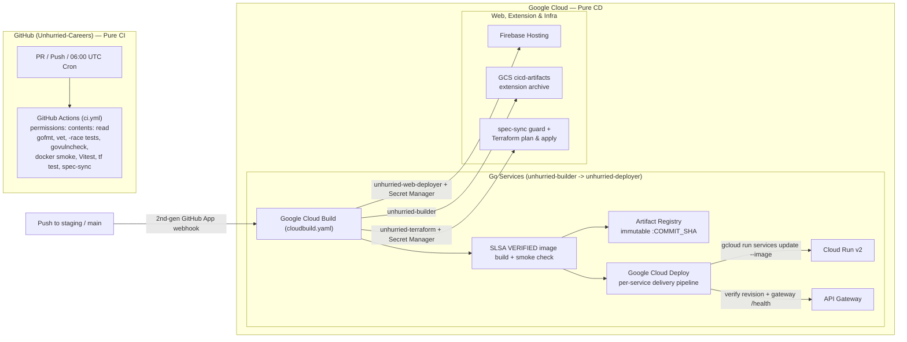

# CI/CD

Unhurried splits **Continuous Integration (CI)** and **Continuous Delivery (CD)** cleanly across GitHub and Google Cloud:

- **Continuous Integration (GitHub Actions — `.github/workflows/ci.yml`)**: Runs tests, static analysis, coverage gates, vulnerability scans (`govulncheck`, `npm audit`, Checkov), OpenAPI spec sync checks, and container smoke tests on every pull request, push to `dev`/`staging`/`main`, and daily `06:00 UTC` schedule. Workflows run with `permissions: contents: read` only and hold **zero Google Cloud credentials or deployment secrets**.
- **Continuous Delivery (Google Cloud — `cloudbuild.yaml` + Google Cloud Deploy)**: Triggered on pushes to each environment's branch (`^main$` in production, `^staging$` in staging) via Cloud Build's 2nd-generation GitHub App connection. Builds SLSA-provenance-verified images into **Artifact Registry**, rolls out **Cloud Run** revisions with post-deploy health verification and one-click rollbacks via **Google Cloud Deploy**, publishes the frontend to **Firebase Hosting**, archives the Chrome extension to **Cloud Storage**, and applies **Terraform** using secrets stored exclusively in **Google Secret Manager**.

## Branches and environments

| Branch | GitHub Actions CI | Google Cloud CD | Status |
| --- | --- | --- | --- |
| `dev` | `.github/workflows/ci.yml` | None: CI only, the default branch where work happens | Active |
| `main` | `.github/workflows/ci.yml` | Production (`project-191091d4-b2e5-4294-9e7`), https://unhurried-careers.com (`production` Cloud Deploy target) | Active |
| `staging` | `.github/workflows/ci.yml` | Staging (`STAGING_PROJECT_ID`), https://unhurried-careers-staging-web.web.app (`staging` Cloud Deploy target) | Branches and `envs/staging` ready; turns on as soon as the staging GCP project is created and applied |
| pull requests | `.github/workflows/ci.yml` | None (never touches GCP) | Active |
| `06:00 UTC` daily cron | `.github/workflows/ci.yml` (Go services + `unhurried-infra`) | None | Active |

Work flows `dev → staging → main`. `dev` is the default branch in every repository; promote by merging `dev` into `staging`, then `staging` into `main`, in each repository that changed.

Because each GCP project runs its own Terraform-provisioned Cloud Build triggers locked to `^<deploy_branch>$` (`^main$` in production, `^staging$` in staging), environment isolation is enforced inside Google Cloud IAM and trigger bindings rather than GitHub plan features. Optional manual promotion gates are available directly in Google Cloud Deploy via `require_deploy_approval = true`.

## Architecture



## Pipeline files per repository

- **`.github/workflows/ci.yml`** (all 9 code repositories): pure CI checks on pull requests, pushes to `dev`, `staging`, and `main`, `workflow_dispatch`, and daily `06:00 UTC` cron (Go services and `unhurried-infra`). Never authenticates to Google Cloud.
- **`cloudbuild.yaml`** (the 8 deployable repositories: 5 Go services, `unhurried-web`, `unhurried-extension`, `unhurried-infra`): pure CD pipeline invoked by Cloud Build 2nd-gen push triggers on `^<deploy_branch>$`. Every `cloudbuild.yaml` sets `options.logging: CLOUD_LOGGING_ONLY` (required for custom least-privilege trigger service accounts) and `options.substitutionOption: ALLOW_LOOSE`.

### Go services (`job-search`, `resume`, `applications`, `notifications`, `inbox`)

| Plane | File | Steps |
| --- | --- | --- |
| **CI (GitHub Actions)** | `.github/workflows/ci.yml` | Checks out service + sibling `unhurried-common` (the same branch for `main` and `staging` pushes and PRs, `dev` otherwise) · `gofmt -l` · `go vet ./...` · `go test -race -covermode=atomic -coverpkg=./... -coverprofile=coverage.out ./...` · publishes coverage summary + artifact · `govulncheck` on source · `docker build` · verifies `nonroot:nonroot` user, auth-config startup refusal, and `/health` smoke check · extracts `/server` and runs `govulncheck -mode=binary` |
| **CD (Cloud Build + Cloud Deploy)** | `cloudbuild.yaml` | Clones `unhurried-common` via a short-lived token minted from the Cloud Build v2 connection · builds `us-central1-docker.pkg.dev/<project>/unhurried/<service>:<COMMIT_SHA>` · verifies `nonroot:nonroot` user and auth-config startup refusal · pushes image with `requestedVerifyOption: VERIFIED` (SLSA provenance) · creates immutable Cloud Deploy release `rel-<SHORT_SHA>-<BUILD_ID_PREFIX>` · Cloud Deploy custom target `cloud-run-image` updates `--image` as `unhurried-deployer` and runs a `VERIFY` job checking both the Cloud Run ready revision and `https://<gateway_hostname>/health` |

Why a Cloud Deploy **Custom Target Type** (`cloud-run-image`) instead of the built-in Cloud Run target? Standard Cloud Deploy Cloud Run targets execute `gcloud run services replace` from a rendered YAML manifest, which would overwrite or revert Terraform-owned environment variables (`ALLOWED_EMAILS`, `APPCHECK_REQUIRED`, `KMS_KEY_NAME`), Secret Manager bindings, and `custom_audiences`. Our `cloud-run-image` custom target updates **only** `--image`, matching `modules/service`'s `lifecycle.ignore_changes` while retaining Cloud Deploy's release history, approval gates, verification phase, and one-click rollbacks.

### `unhurried-common`

 CI-only shared library (`.github/workflows/ci.yml`): runs `gofmt -l`, `go vet ./...`, `go test -race -covermode=atomic -coverprofile=coverage.out ./...`, coverage summary + artifact upload, and `govulncheck` on pull requests and pushes. Daily `06:00 UTC` scheduled runs across all five Go services test against the latest `unhurried-common`. In GCP, `unhurried-common` is linked as a Cloud Build 2nd-gen repository resource (with no trigger) so Go service CD pipelines can mint ephemeral read tokens for it.

### `unhurried-web`

| Plane | File | Steps |
| --- | --- | --- |
| **CI (GitHub Actions)** | `.github/workflows/ci.yml` | `npm ci` · `npm run typecheck` · `npm run test:coverage` (85% lines, 75% branches) + coverage summary & artifact · production build smoke check · `npm audit --omit=dev --audit-level=high` |
| **CD (Cloud Build)** | `cloudbuild.yaml` | `npm ci` · injects `unhurried-web-build-config` from Secret Manager via `availableSecrets` + `_CANONICAL_ORIGIN` · builds `dist/` without leaking `WEB_BUILD_CONFIG` to logs · verifies `dist/assets` embeds `VITE_FIREBASE_PROJECT_ID` and `VITE_INBOX_API` with zero `localhost:80xx` URLs · publishes via `npx firebase target:apply` and `npx firebase deploy --only hosting:web --message "$COMMIT_SHA"` as `unhurried-web-deployer` |

### `unhurried-extension`

- **CI (`.github/workflows/ci.yml`)**: `npm ci`, `npm run test:coverage` (90% line threshold), `npm run build`, Manifest V3 assertion on `dist/manifest.json`, and `dist/` workflow artifact upload.
- **CD (`cloudbuild.yaml`)**: `npm ci && npm run build`, Manifest V3 assertion on `dist/manifest.json`, and archives `unhurried-extension-${COMMIT_SHA}.tar.gz` to `gs://<project>-cicd-artifacts/extension/`.

### `unhurried-infra`

| Plane | File | Steps |
| --- | --- | --- |
| **CI (GitHub Actions)** | `.github/workflows/ci.yml` | `terraform fmt -check -recursive -diff` · matrix `init -backend=false`, `validate`, and `test` (mocked providers, no credentials) across all 8 modules (`service`, `data`, `auth`, `hosting`, `google_oauth`, `docs`, `mail`, `cicd`) and both environments (`envs/staging`, `envs/prod`) · `tools/check-specs.mjs` gateway spec linter · matrix spec-sync diff against `openapi.yaml` in all 5 service repos · Checkov Terraform scan (`soft_fail: true`) |
| **CD (Cloud Build)** | `cloudbuild.yaml` | Runs `tools/check-specs.mjs` and `verify-gateway-spec-sync` (via Cloud Build v2 `accessReadToken`) as a pre-apply safety guard · reads `unhurried-google-oauth-client-secret` (required) and `unhurried-smtp-password` (optional) from Secret Manager into an isolated `/tf-secrets` volume · runs `terraform init -reconfigure`, `plan -lock-timeout=10m -out=tfplan`, and `apply -lock-timeout=10m tfplan` against `gs://<project>-tfstate` as `unhurried-terraform` |

## Least-privilege identities & secrets

### Google Cloud CD service accounts

`unhurried-infra/modules/cicd` (plus `modules/hosting`) provisions four dedicated CD service accounts per environment:

| Service account | Used by | Permissions |
| --- | --- | --- |
| `unhurried-builder` | `<service>-deploy` and `unhurried-extension-package` triggers | `roles/logging.logWriter`, `roles/cloudbuild.readTokenAccessor`, `roles/artifactregistry.writer` on `unhurried`, `roles/storage.objectAdmin` on `<project>-cicd-artifacts`, `roles/clouddeploy.releaser`, and `iam.serviceAccountUser` on `unhurried-deployer`. Cannot modify Cloud Run directly |
| `unhurried-deployer` | Google Cloud Deploy `RENDER`, `DEPLOY`, and `VERIFY` jobs | `roles/clouddeploy.jobRunner`, `roles/artifactregistry.reader` on `unhurried`, `roles/storage.objectAdmin` on `<project>-cicd-artifacts`, `roles/run.developer` on each listed Cloud Run service only, and `iam.serviceAccountUser` on each service's `<service>-run` runtime SA |
| `unhurried-web-deployer` | `unhurried-web-deploy` trigger | `roles/firebasehosting.admin`, `roles/logging.logWriter`, and `roles/secretmanager.secretAccessor` on `unhurried-web-build-config` only |
| `unhurried-terraform` | `unhurried-infra-apply` trigger | `roles/owner`, `roles/logging.logWriter`, and `roles/cloudbuild.readTokenAccessor` |

### Secret boundaries (GitHub vs Google Cloud)

1. **Zero GCP credentials or deployment secrets in GitHub**: No GCP Workload Identity Federation, service account keys, OAuth secrets, or SMTP passwords exist in GitHub Actions.
2. **GitHub CI cross-repo read App (`CI_APP_CLIENT_ID` + `CI_APP_PRIVATE_KEY`)**: Because `Unhurried-Careers` repositories are private, an internal GitHub App owned by `Unhurried-Careers` (`Unhurried-Careers CI Reader`, `Contents: Read-only` only, webhooks disabled) is installed on `unhurried-common` and the 5 Go service repos. Only the **6 repositories** that read sibling repos during CI (`5 Go services` + `unhurried-infra`) store `CI_APP_CLIENT_ID` and `CI_APP_PRIVATE_KEY`, and mint 1-hour auto-revoked tokens via `actions/create-github-app-token@v3` downscoped to the exact target repo (`unhurried-common` or `${{ matrix.repo }}`). Zero personal access tokens exist, and `unhurried-common`, `unhurried-web`, `unhurried-extension`, and `unhurried-product` have zero GitHub secrets.
3. **Google Cloud CD cross-repo clones without PATs**: Inside Cloud Build, steps call `POST https://cloudbuild.googleapis.com/v2/.../repositories/<repo>:accessReadToken` using their GCP service account identity to mint a short-lived, read-only GitHub App token and pass it via a transient `http.https://github.com/.extraheader` git flag (never written to `.git/config` or logs).
4. **Deployment & runtime secrets in GCP Secret Manager**: `unhurried-google-oauth-client-secret`, `unhurried-smtp-password`, and `unhurried-web-build-config` live exclusively in each environment's Google Secret Manager.

## Runbooks

### One-time bootstrap of the GitHub connection in an environment

Google Cloud Build's 2nd-generation GitHub connection requires a one-time OAuth / GitHub App installation handshake on the `Unhurried-Careers` GitHub organization:

1. Apply Terraform first with `github_connection_ready = false` in `envs/<env>/settings.auto.tfvars` (or `-var="github_connection_ready=false"`):
   ```bash
   cd unhurried-infra/envs/prod
   terraform apply -var="github_connection_ready=false"
   ```
   This enables the Cloud Build / Cloud Deploy APIs, creates the CD service accounts, Cloud Deploy pipelines, and `google_cloudbuildv2_connection.github`.
2. Inspect `terraform output cicd` — `github_connection_state` displays `stage = "PENDING_USER_OAUTH"` (or `PENDING_INSTALL_APP`) along with an `action_uri` link (also reachable in Google Cloud Console → **Cloud Build → Repositories → 2nd gen**).
3. Open `action_uri` once as an `Unhurried-Careers` GitHub org admin to authorize the Google Cloud Build GitHub App for the organization's repositories. (`lifecycle.ignore_changes = [github_config]` ensures Terraform preserves the credential Google Cloud writes back.)
4. Set `github_connection_ready = true` (the default) and run `terraform apply` once more. Terraform links all 9 repositories and provisions all branch CD triggers.

### Release to production

1. Commit to `dev` or open pull requests against it (GitHub Actions runs `.github/workflows/ci.yml`). Merge `dev` into `staging` and verify staging Cloud Build / Cloud Deploy rollouts.
2. Merge `staging` into `main`. When changes span repositories, merge in order: `unhurried-common` → Go service repos → `unhurried-infra` → `unhurried-web` (so `unhurried-infra`'s `verify-gateway-spec-sync` guard sees the updated `openapi.yaml` on `main`).
3. Watch CD builds and rollouts in Google Cloud Console (**Cloud Build → History** and **Cloud Deploy → Delivery pipelines**) or via CLI:
   ```bash
   gcloud builds list --region=us-central1 --project=project-191091d4-b2e5-4294-9e7 --limit=10
   gcloud deploy rollouts list --delivery-pipeline=unhurried-inbox --release=- --region=us-central1 --project=project-191091d4-b2e5-4294-9e7
   ```
4. If `require_deploy_approval = true` is enabled on the environment, approve pending Cloud Deploy rollouts in the Cloud Deploy console or via `gcloud deploy rollouts approve <rollout> --delivery-pipeline=<service> --release=<release> --region=us-central1`.

### Roll back

| What | How |
| --- | --- |
| A Go service | In **Google Cloud Deploy → Delivery pipelines → `<service>`**, click **Roll back** on the target (or run `gcloud deploy targets rollback production --delivery-pipeline=<service> --region=us-central1 --project=<project>`). Cloud Deploy rolls out the previous verified SHA image and re-runs health verification; then revert the commit on `main` |
| The web app | Firebase Console → Hosting → release history → Roll back (or `npx firebase hosting:rollback`), then revert the commit on `main` |
| Infrastructure | Revert the commit on `main`; `unhurried-infra-apply` plans and applies the previous configuration. Firestore and KMS keys have deletion protection |

### Turn on staging

Covered in `unhurried-infra/README.md`: create the staging GCP project, link billing, enable prerequisite APIs, create the versioned `<project>-tfstate` bucket, configure Google Auth Platform + reCAPTCHA Enterprise, fill `envs/staging/settings.auto.tfvars` and local `envs/staging/terraform.tfvars`, seed initial service images, complete the 2-step GitHub connection bootstrap above, and push to `staging`. No code or pipeline YAML edits are needed in any repository because triggers pass project/branch substitutions automatically.

### Add a service

1. Create the repository from an existing service and render `.github/workflows/ci.yml` and `cloudbuild.yaml` from `.local-run/go-service-ci.yml.tmpl` and `.local-run/go-service-cloudbuild.yaml.tmpl` (replacing `__SVC__`), add the new repository to the `Unhurried-Careers CI Reader` GitHub App installation, and set `CI_APP_CLIENT_ID` + `CI_APP_PRIVATE_KEY` on the new repository.
2. Add the service to `local.services` (and `local.internal_callers` if needed) in `envs/prod/main.tf` and `envs/staging/main.tf`, and copy its `openapi.yaml` into `unhurried-infra/gateway-specs/`.
3. Add the service to the `spec-sync` matrix in `unhurried-infra/.github/workflows/ci.yml` and `verify-gateway-spec-sync` in `unhurried-infra/cloudbuild.yaml`, and add its `VITE_*_API` entry to `local.web_build_config` if called from `unhurried-web`.
4. Seed its initial image in Artifact Registry and apply Terraform (`module.cicd` automatically links the repository, grants IAM, and creates its deploy trigger and Cloud Deploy delivery pipeline).

### Rotate the OAuth client secret

1. Create a new client secret on the Web OAuth client in Google Auth Platform.
2. Update `envs/prod/terraform.tfvars` locally (or add a new version directly to `unhurried-google-oauth-client-secret` in Secret Manager: `printf '%s' "$NEW_SECRET" | gcloud secrets versions add unhurried-google-oauth-client-secret --data-file=- --project=project-191091d4-b2e5-4294-9e7`) and run `unhurried-infra-apply` (updates Identity Platform and Secret Manager).
3. Trigger a rollout of `unhurried-inbox` and `unhurried-resume` so new Cloud Run revisions pick up `latest`, then delete the old secret in Google Auth Platform.

### Bootstrap or rotate the GitHub CI Reader App

- **Initial setup**: Run `node unhurried-infra/tools/setup-ci-github-app.mjs` to launch the 2-click GitHub App Manifest registration + installation flow, verify downscoped token minting, and set `CI_APP_CLIENT_ID` + `CI_APP_PRIVATE_KEY` across all 6 CI reader repositories.
- **Key rotation**: Generate a new private key on the `Unhurried-Careers CI Reader` GitHub App, run `node unhurried-infra/tools/setup-ci-github-app.mjs --client-id <Iv23...> --private-key-file <new-key.pem>`, delete the `.pem` file from disk, and revoke the old key in GitHub App settings.

### CI/CD Pipeline Status Dashboard

A dedicated real-time observability dashboard is maintained in `unhurried-product/dashboard/`:
- **Real-Time Matrix**: Monitors CI status across all 10 repositories (5 Go backend services, `unhurried-web`, `unhurried-extension`, `unhurried-infra`, `unhurried-common`, and `unhurried-product`).
- **Deep Step Inspection**: Inspects all individual CI steps (`gofmt`, `go vet`, `go test -race`, `govulncheck`, `Docker smoke check`, `typecheck`, `spec-sync`) and Cloud Deploy targets.
- **Run Directly**: Open `dashboard/index.html` in any browser or run `npm start` in `dashboard/` to serve at `http://localhost:3000`.
- **Data Snapshot**: Run `npm run fetch` in `dashboard/` to update `dashboard/data/ci-status.json`.

### Troubleshooting

| Symptom | Cause |
| --- | --- |
| GitHub Actions `create-github-app-token` fails | The `Unhurried-Careers CI Reader` GitHub App installation does not include the target repository, or `CI_APP_CLIENT_ID` / `CI_APP_PRIVATE_KEY` is missing; check GitHub → Organization Settings → GitHub Apps or re-run `setup-ci-github-app.mjs` |
| `google_cloudbuildv2_repository` fails on first `terraform apply` | The GitHub connection hasn't completed the one-time OAuth app handshake yet; apply once with `-var="github_connection_ready=false"`, open `action_uri` from `terraform output cicd`, then apply with `github_connection_ready=true` |
| `accessReadToken` returns 403 when cloning `unhurried-common` or `openapi.yaml` in Cloud Build | The Google Cloud Build GitHub App installation in GitHub org settings does not include that private repository; grant repository access in GitHub → Organization Settings → Installed GitHub Apps |
| Spec-sync fails in `unhurried-infra` | A service's `openapi.yaml` changed without copying it into `unhurried-infra/gateway-specs/` (or vice versa) |
| Cloud Deploy `VERIFY` phase fails | Either the new Cloud Run revision failed startup health checks (previous revision continues serving traffic) or the gateway `/health` endpoint returned an error; inspect Cloud Deploy verification logs |
| `terraform apply` waits on the state lock | Another apply is running; if a build was force-cancelled, run `terraform force-unlock <id>` after confirming no build is active |
| Web deploy fails the bundle check | `unhurried-web-build-config` in Secret Manager is missing a field, or Terraform has not yet been applied in that environment |
